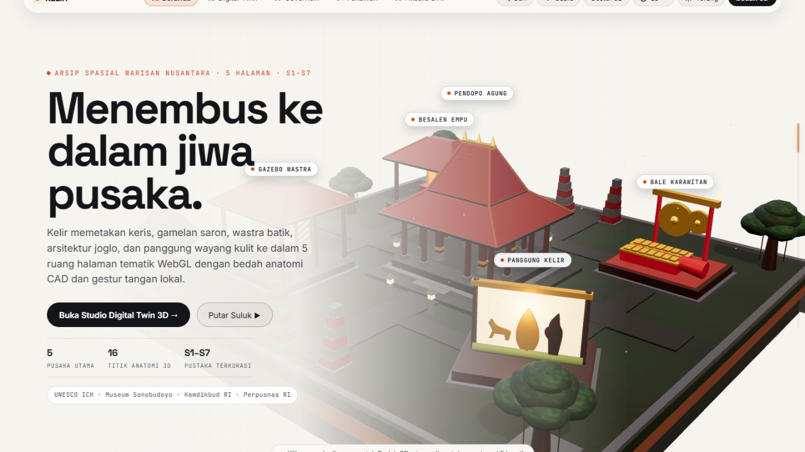
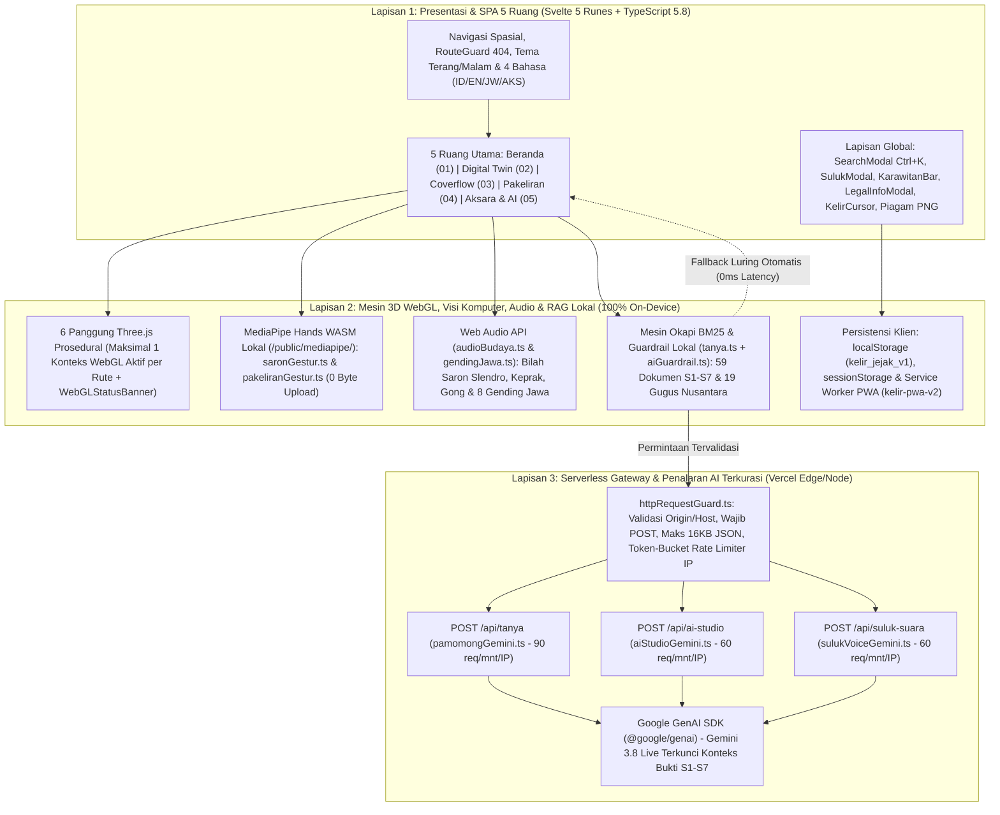
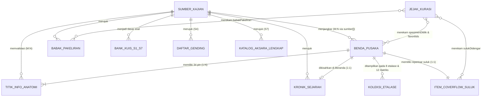
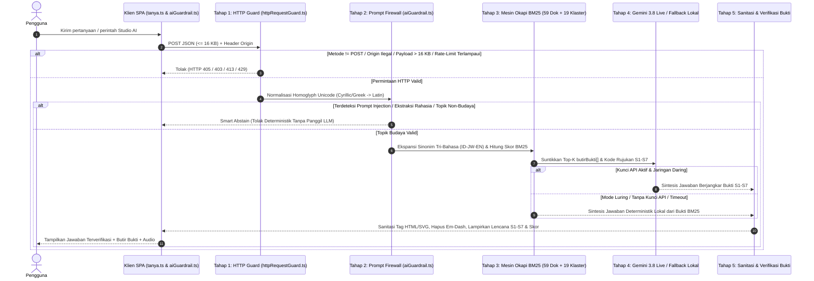

# KELIR (`ꦏꦼꦭꦶꦂ`) - Platform Eksibisi Spasial 3D Warisan Budaya Nusantara, Studio Digital Twin CAD, Panggung Pakeliran & Agen AI Berbasis Rujukan

[](https://kelir-phi.vercel.app)
[](#tumpukan-teknologi)
[](#arsitektur-5-ruang-kurasi-spasial)
[](#tumpukan-teknologi)
[](#kinematika-gestur-tangan-21-titik-lokal-mediapipe)
[](#05---studio-ai-pamomong-nusantara--laboratorium-aksara-jawa-ua980-halkawruh)
[](#mesin-temu-balik-okapi-bm25--pagar-keamanan-ai-5-tahap)
[](#matriks-pengujian-otomatis--jaminan-kualitas)
[](#sistem-desain-responsivitas-mobile--aksesibilitas-wcag-21-aa)
[](#fitur-sistem-lintas-ruang)
[](./LICENSE)



**KELIR (`ꦏꦼꦭꦶꦂ`)** adalah aplikasi web progresif (*Progressive Web Application*) dan platform eksibisi budaya spasial berbasis **WebGL 3D prosedural** yang menyatukan diorama arsitektur Pendopo Jawa, studio pembedahan anatomi **Digital Twin CAD/PBR** berpresisi tinggi, panggung bayangan **Pakeliran Wayang Kulit 3D** berkendali dua tangan, laboratorium **86 karakter Aksara Jawa Hanacaraka (`U+A980-U+A9DF`)**, sintesis ansambel **Karawitan Klasik Jawa (`Web Audio API`)**, pelacakan gestur tangan 21 titik secara lokal di peramban (`MediaPipe Hands`), serta agen kecerdasan budaya **Pamomong Nusantara** yang terjangkar ketat pada arsip rujukan primer (`S1-S7`) dan ensiklopedia 38 provinsi Nusantara.

Dirancang dengan sistem desain museum kuratorial dua tema, yakni **Washi Alabaster** (Mode Terang) dan **Smoked Obsidian & Kayu Jati** (Mode Malam), KELIR beroperasi secara responsif mulai dari layar *desktop widescreen* (`1440px+`), *tablet*, hingga perangkat seluler (`320px`) serta mampu berjalan penuh dalam keadaan luring (*offline-first*) melalui *Service Worker* (`kelir-pwa-v2`).

- **Akses Aplikasi Langsung (Live Production)**: [https://kelir-phi.vercel.app](https://kelir-phi.vercel.app)
- **Repositori Kode Sumber**: [https://github.com/xFalzz/kelir](https://github.com/xFalzz/kelir)

---

## Daftar Isi

1. [Ringkasan Kapabilitas Utama](#ringkasan-kapabilitas-utama)
2. [Arsitektur Sistem Tiga Lapis & Siklus Hidup WebGL](#arsitektur-sistem-tiga-lapis--siklus-hidup-webgl)
3. [Arsitektur 5 Ruang Kurasi Spasial](#arsitektur-5-ruang-kurasi-spasial)
   - [01. Beranda & Diorama Hidup (`?hal=beranda`)](#01---beranda--diorama-hidup-halberanda)
   - [02. Studio Digital Twin CAD 3D (`?hal=twin`)](#02---studio-digital-twin-cad-3d-haltwin)
   - [03. Galeri Coverflow 3D & Modal Suluk (`?hal=koleksi`)](#03---galeri-coverflow-3d--modal-suluk-halkoleksi)
   - [04. Panggung Pakeliran Wayang Kulit 3D (`?hal=pakeliran`)](#04---panggung-pakeliran-wayang-kulit-3d-halpakeliran)
   - [05. Studio AI Pamomong Nusantara & Lab Aksara Jawa (`?hal=kawruh`)](#05---studio-ai-pamomong-nusantara--laboratorium-aksara-jawa-ua980-halkawruh)
4. [Kinematika Gestur Tangan 21-Titik Lokal (`MediaPipe`)](#kinematika-gestur-tangan-21-titik-lokal-mediapipe)
5. [Skema Data Relasional & Persistensi Klien](#skema-data-relasional--persistensi-klien)
6. [Mesin Temu-Balik Okapi BM25 & Pagar Keamanan AI 5 Tahap](#mesin-temu-balik-okapi-bm25--pagar-keamanan-ai-5-tahap)
7. [Mesin Audio Prosedural Web Audio API & 8 Gending Karawitan](#mesin-audio-prosedural-web-audio-api--8-gending-karawitan)
8. [Sistem Desain, Responsivitas Mobile & Aksesibilitas WCAG 2.1 AA](#sistem-desain-responsivitas-mobile--aksesibilitas-wcag-21-aa)
9. [Fitur Sistem Lintas Ruang](#fitur-sistem-lintas-ruang)
10. [Spesifikasi Endpoint Serverless API (`/api/*`)](#spesifikasi-endpoint-serverless-api-api)
11. [Rujukan Pustaka Primer (`S1-S7`)](#rujukan-pustaka-primer-s1-s7)
12. [Tumpukan Teknologi](#tumpukan-teknologi)
13. [Struktur Direktori Repositori](#struktur-direktori-repositori)
14. [Memulai, Konfigurasi & Skrip Pengembangan](#memulai-konfigurasi--skrip-pengembangan)
15. [Matriks Pengujian Otomatis & Jaminan Kualitas](#matriks-pengujian-otomatis--jaminan-kualitas)
16. [Lisensi Pribadi & Hak Cipta](#lisensi-pribadi--hak-cipta-english--indonesia)
17. [Kontak Pengelola & Pengembang](#kontak-pengelola--pengembang)

---

## Ringkasan Kapabilitas Utama

| Pilar Platform | Spesifikasi Teknis Terimplementasi |
| :--- | :--- |
| **Arsitektur Ruang Spasial** | 5 halaman kuratorial terintegrasi melalui *URL query state* (`?hal=beranda \| twin \| koleksi \| pakeliran \| kawruh`), *deep-linking* objek & pin anatomi (`?benda=...&titik=...`), serta validasi *RouteGuard* 404 cerdas (`routeGuard.ts`) |
| **Geometri 3D Prosedural & CAD** | 6 panggung `Three.js` murni prosedural tanpa ketergantungan berkas `.glb/.gltf` eksternal berukuran berat, mencakup 7 spesimen pusaka, 34 titik pin anatomi 3D, 12 pelat matriks `KLR-01` s.d. `KLR-12`, mode `PBR Nyata`, `Hibrida`, `Rangka Kawat X-Ray CAD`, dan penggeser *Exploded View* (`0%-100%`) |
| **Visi Komputer Tanpa Sentuh** | Pelacakan 21 titik persendian tangan secara lokal (`@mediapipe/tasks-vision` WASM di `public/mediapipe/`) untuk menabuh 6 bilah *Saron Slendro* (`saronGestur.ts`) dan mengendalikan wayang dua tangan multi-derajat kebebasan (`pakeliranGestur.ts`) dengan **0 byte unggahan video ke server** |
| **Agen AI & Grounding Budaya** | **Pamomong Nusantara** + 6 Mode **AI Studio** (`Tanya S1-S7`, `Komparator AI`, `Pujangga & Suara`, `Krama & Aksara AI`, `Rute Tur AI`, `Kuis Kurasi`) yang menggabungkan temu-balik deterministik **Okapi BM25** (59 dokumen `S1-S7` + 19 gugus Ensiklopedia Nusantara 38 provinsi) dengan inferensi **Gemini 3.8 Live** dan *fallback* luring otomatis |
| **Pagar Keamanan Siber AI** | Pipeline pertahanan 5 tahap (`httpRequestGuard.ts` + `aiGuardrail.ts`): pembatasan metode `POST`, validasi *Origin*, batas *payload* `16 KB`, *rate-limiter* IP, normalisasi *homoglyph* Unicode Cyrillic/Greek, pemblokiran *prompt injection/jailbreak*, mekanisme *Smart Abstain*, dan sanitasi keluaran |
| **Laboratorium Aksara Jawa** | Katalog interaktif 86 entri aksara pada blok Unicode `U+A980-U+A9DF` lintas 6 kategori (`Nglegena`, `Sandhangan`, `Pasangan`, `Swara & Rekaan`, `Aksara Murda`, `Angka & Pada`) dilengkapi mesin transliterasi dua pakem (`aksara.ts`) |
| **Sintesis Akustik Karawitan** | Mesin `Web Audio API` prosedural (`audioBudaya.ts`, `gendingJawa.ts`) yang menyintesis 8 gending klasik Jawa berdasar notasi Kepatihan asli, ombak pelarasan *pengumbang-pengisep* (`±5.5 cents`), gema ruang pendopo `1.85 detik`, ketukan *keprak/gong*, dan peredupan suara latar otomatis (*audio ducking*) |
| **Multibahasa, Aksesibilitas & PWA** | 4 bahasa aktif (`ID`, `EN`, `JW`, `AKS`) berbasis `i18next`, skala teks `A / A+`, kepatuhan penuh **WCAG 2.1 Level AA** (`focusTrap.ts`, kontras warna, target sentuh `>= 44x44px`), *Floating Bottom Dock* responsif di ponsel, generator **Piagam Kurator PNG (`1400x920px`)**, serta *Service Worker* PWA luring |

---

## Arsitektur Sistem Tiga Lapis & Siklus Hidup WebGL

KELIR menerapkan pola arsitektur **Client-First Spatial Web Application** dengan pemisahan tanggung jawab ke dalam tiga lapisan utama agar seluruh interaksi grafis 3D, visi komputer, sintesis audio, dan pencarian rujukan tetap berjalan instan meskipun koneksi jaringan pengguna terputus.



### Manajemen Siklus Hidup Konteks Tunggal WebGL (`threeHelpers.ts`)
Untuk mencegah kebocoran memori GPU (*VRAM leak*) dan galat `Too many active WebGL contexts` pada perangkat seluler:
- **Satu Konteks WebGL Aktif per Halaman**: Saat pengguna berpindah rute `?hal=...`, panggung 3D sebelumnya dihancurkan secara tuntas (`disposeStage`) dengan membebaskan seluruh `BufferGeometry`, `Material`, `Texture`, `RenderTarget`, `PMREMGenerator`, serta menghentikan loop `requestAnimationFrame`.
- **Kompilasi Shader Asinkron & Pemulihan Konteks**: Fungsi `compileSceneAsync()` memanfaatkan `renderer.compileAsync()` sebelum frame pertama digambar untuk menghindari *shader stutter*. Komponen `WebGLStatusBanner.svelte` memantau kejadian `webglcontextlost` dan `webglcontextrestored` secara *real-time* serta menyediakan tombol pemulihan panggung 3D tanpa memuat ulang halaman.
- **Perender Potret Offscreen Terjadwal (`etalaseSnapshotRenderer.ts`)**: Kartu Etalase pada Beranda dirender secara *lazy-cached* di memori menjadi citra statis beresolusi terkalibrasi sehingga tidak membebani konteks WebGL utama.

---

## Arsitektur 5 Ruang Kurasi Spasial

### 01 - Beranda & Diorama Hidup (`?hal=beranda`)
- **Diorama Suaka Budaya 3D (`LivingPendopoStage`)**: Kompleks lanskap kepulauan dan arsitektur Jawa 3D berbasis PBR dengan pencahayaan studio PMREM prosedural yang memuat 5 zona bangunan pusaka:
  1. **Pendopo Joglo Agung**: Konstruksi *saka guru* 4 tiang utama, 12 *saka pengeret*, atap bertingkat *tumpang sari*, *umpak* batu andesit, dan lampu gantung *robyong*.
  2. **Besalen Empu Keris**: Tungku *prapen* membara, *ububan* tabung bambu kembar, landasan *paron*, dan ragam bilah *dhuwung*.
  3. **Gazebo Wastra Batik**: Gawangan kayu jati dengan helai kain *Batik Tulis Kawung* yang bergerak mengikuti gelombang sinus fisik ~30Hz beserta wajan *malam* dan *canting* tembaga.
  4. **Bale Karawitan**: Rancakan kayu jati berukir, bilah *Saron Barung*, *Kendhang*, dan *Gayor Gong Ageng* bersepuh perunggu.
  5. **Panggung Kelir Wayang**: Layar *kelir* blacu berbingkai *gawangan*, lampu *blencong*, *Gunungan Kayon*, dan siluet wayang kulit.
- **Mode Rangka Kawat X-Ray CAD (`Rangka Kawat CAD`)**: Tombol inspeksi struktural pada kartu telemetri maupun bilah navigasi yang menyalakan jaring rusuk struktural (*CAD wireframe overlay*) berwarna kontras tinggi di atas geometri diorama baik pada Mode Terang maupun Mode Malam.
- **Scrollytelling 5 Babak Kronik Sejarah (`01` s.d. `05`)**: Narasi kuratorial bertipografi angka piksel SVG (`PixelNumber.svelte`) yang menggerakkan orbit kamera 3D, target fokus zona bangunan, dan indikator telemetri secara sinkron saat halaman digulir.
- **Dinding Indeks 12 Matriks Anatomi (`KLR-01` s.d. `KLR-12`) & Etalase Horizontal**: Kisi 12 pelat anatomi perspektif 3D dan 8 kartu potret studio PBR (`BerandaWallEtalase.svelte`) yang membawa pengguna langsung ke titik pin anatomi terkait di Studio Digital Twin.

### 02 - Studio Digital Twin CAD 3D (`?hal=twin`)
Studio inspeksi rekayasa (`DigitalTwinStudio.svelte` & `digitalTwinStage.ts`) yang memungkinkan pembedahan struktur internal **7 spesimen pusaka** dan **34 titik pin anatomi 3D**:

| No | ID Spesimen | Nama Spesimen & Aksara Jawa | Kategori Kurasi | Titik Pin 3D | Sub-Rakitan Geometri & Parameter CAD | Rujukan | Interaksi Khusus |
| :-: | :--- | :--- | :--- | :-: | :--- | :-: | :--- |
| 1 | `keris-luk-5` | **Keris Luk 5 Pandhawa Lare** (`ꦏꦼꦫꦶꦱ꧀ꦭꦸꦏ꧀꧇꧕꧇`) | Tosan Aji | **6 Pin** | Wilah Luk 5, Pamor Beras Wutah, Ganja Sebit Rontal, Pesi Inti, Mendak Selut Mirah, Warangka Gayaman Timoho | `S1`, `S7` | Exploded View 6 lapis & Kurator AI per pin |
| 2 | `saron-slendro` | **Saron Laras Slendro** (`ꦱꦫꦺꦴꦤ꧀ꦱ꧀ꦭꦼꦤ꧀ꦢꦿꦺꦴ`) | Karawitan | **5 Pin** | 6 Bilah Gangsa (`78% Cu / 22% Sn`), Paku Tawonan Simpul Getar, Rancakan Jati, Palungan Resonator, Tabuh Gandhen | `S4` | **Tabuh 6 Nada (`1 2 3 5 6 1'`)** via klik, keyboard, atau **Gestur Jari Kamera** |
| 3 | `batik-kawung` | **Batik Tulis Kawung** (`ꦧꦶꦏ꧀ꦠꦸꦭꦶꦱ꧀ꦏꦮꦸꦁ`) | Wastra | **5 Pin** | Geometri Papat Pancer, Isen Cecekan, Paruh Canting `0.4 mm`, Lapisan Malam Tembaga, Serat Mori Primissima | `S2` | Simulasi gelombang kain & bedah lapisan malam |
| 4 | `pendopo-joglo` | **Pendopo Joglo Agung** (`ꦥꦼꦤ꧀ꦝꦥꦗꦺꦴꦒ꧀ꦭꦺꦴ`) | Arsitektur | **5 Pin** | 4 Saka Guru & Purusan, Tumpang Sari 5 Tingkat, Sunduk-Kili Penahan Geser, Umpak Andesit, Atap Tajug | `S6` | Bedah sambungan kayu tahan gempa tanpa paku |
| 5 | `wayang-rama` | **Wayang Kulit Purwa Sri Rama** (`ꦮꦪꦁꦏꦸꦭꦶꦠ꧀ꦯ੍ਰੀꦫာမ`) | Pakeliran | **5 Pin** | Tatahan Kulit Kerbau, Gapit Tanduk Kerbau, Cempurit Tangan, Sunggingan Prada Emas, Pelita Blencong | `S3`, `S5` | Inspeksi perforasi tatahan & bayangan kelir |
| 6 | `kidang-kencana` | **Kidang Kencana & Blencong** (`ꦏꦶꦢꦁꦏꦼꦚ꧀ꦕꦤ`) | Pakeliran | **4 Pin** | Tanduk Krawangan Emas, Artikulasi Tungkai Depan, Sumbu Pelita Blencong, Bias Siluet Layar Blacu | `S3`, `S5` | Geometri dua sisi (*dual-sided*) & simulasi sorot |
| 7 | `prasasti-aksara` | **Prasasti Hanacaraka `U+A980`** (`ꦥꦿꦱꦱ꧀ꦠꦶꦲꦤꦕꦫꦏ`) | Aksara | **4 Pin** | Pahatan 20 Carakan Dasar, Baris Pasangan & Sandhangan, Bingkai Batu Andesit, Indeks Blok Unicode `U+A980` | `S7` | Tautan langsung ke Lab Konversi 86 Aksara |

- **3 Mode Rendering Visual**: `PBR Nyata` (material fisik bertekstur kayu, perunggu, besi-nikel, dan kulit), `Hibrida` (material PBR disertai garis rusuk teknis), serta `Rangka Kawat X-Ray CAD` (transparansi struktural penuh).
- **Tuas Ledak Anatomi (`Exploded View 0%-100%`)**: Menggeser setiap sub-komponen sepanjang vektor ledak 3D (`explodeVec: [dx, dy, dz]`) secara mulus untuk memperlihatkan konstruksi sambungan dalam.
- **Ekspor & Deep-Link**: Unduh **Potret Studio 3D (`.png`)**, **Dossier Metrologi Kurasi (`.json`)**, dan salin tautan *deep-link* (`?hal=twin&benda=keris-luk-5&titik=wilah-luk5`).

### 03 - Galeri Coverflow 3D & Modal Suluk (`?hal=koleksi`)
- **Panggung Korsel Melengkung (`CoverflowStage`)**: Tujuh spesimen pusaka ditata di atas pedestal batu andesit berbalut beludru merah marun dan cincin kuningan dalam lintasan kurva 3D interaktif yang dinormalisasi ukurannya dengan `THREE.Box3`.
- **Monograf Kuratorial & Modal Suluk Layar Penuh (`SulukModal.svelte` & `sulukShowcaseStage.ts`)**:
  - Menampilkan panggung altar 3D bercahaya *Blencong* khusus untuk artefak yang dipilih.
  - Menyajikan **5 larik syair suluk sejajar dalam 4 bahasa/aksara** (`Bahasa Indonesia`, `English`, `Basa Jawi`, dan `Aksara Jawa Hanacaraka U+A980`), lengkap dengan pemilih bahasa instan di dalam modal.
  - Dilengkapi tabel metadata Karawitan `2x2` (Laras/Pathet, Instrumen Pengiring, Tempo/Irama, Rujukan Arsip), konsol **Auto-Suluk** beserta iringan ketukan saron/keprak/gong, dan **Narator Vokal Dalang Neural** (`/api/suluk-suara` WAV dengan *fallback* otomatis ke `Web Speech API`).

### 04 - Panggung Pakeliran Wayang Kulit 3D (`?hal=pakeliran`)
- **Teater Bayangan 4 Babak *Lakon Ramayana: Kijang Kencana* (`WayangStage` & `wayang3DBuilder.ts`)**:
  - Memvisualisasikan panggung *Pakeliran* gaya Yogyakarta-Surakarta dengan layar *kelir* kain blacu, bingkai *gawangan* kayu jati berukir, dua batang *gedebog* pisang, deretan wayang *Simpingan* kiri-kanan, *Gunungan Kayon*, tokoh **Sri Rama**, serta **Kidang Kencana** dengan geometri dua sisi yang saling berhadapan.
  - **4 Babak Naratif Terkurasi (`S3` & `S5`)**:
    1. *Babak I - Taman Dandaka & Kemilau Kidang Kencana*
    2. *Babak II - Rayuan Dewi Sinta & Pengejaran di Hutan*
    3. *Babak III - Bidikan Gendewa Guwawijaya*
    4. *Babak IV - Raksasa Kalamarica & Gema Suara Palsu*
- **Meja Kendali Dalang Interaktif**:
  - **3 Mode Pencahayaan Panggung**: `Blencong` (nyala api pelita minyak bergetar hangat), `Siluet Kelir` (tampilan bayangan belakang layar), dan `Sorot Tatahan` (inspeksi detail ukiran kulit).
  - **Aksi Panggung**: Penggeser posisi horizontal wayang, tombol **Sabetan & Keprak** (efek kilatan dan ketukan *cempala* besi/kayu), tombol **Lepaskan Panah Rama** (animasi lintasan busur *Guwawijaya* dengan deteksi tumbukan sasaran), pemutar **Suara Dalang** per babak (`dalangVoice.ts`), serta kendali kamera **Gestur 2 Tangan MediaPipe**.

### 05 - Studio AI Pamomong Nusantara & Laboratorium Aksara Jawa `U+A980` (`?hal=kawruh`)
- **Astrolabe Horologis 3D (`PamomongOrbStage`)**: Objek 3D interaktif berwujud bola astrolabe obsidian-kuningan dengan lensa safir ganda, turbin ekuator 16 bilah, dan 3 cincin gimbal berputar yang bereaksi terhadap posisi gulir halaman (*sticky scroll choreography*) serta status pemrosesan AI.
- **6 Mode Studio AI Pamomong Nusantara (`KawruhOrbSection.svelte`, `aiStudio.ts`)**:
  1. **Tanya Pustaka `S1-S7` & Budaya Nusantara**: Menjawab pertanyaan mendalam mengenai 7 spesimen pusaka (`S1-S7`) maupun 19 gugus budaya dan situs cagar budaya 38 provinsi Indonesia (`nusantaraKB.ts`, termasuk Taman Sari Yogyakarta, Candi Borobudur/Prambanan, Rumah Gadang, Tari Saman, Sasando, Subak Bali, dll.) lengkap dengan lencana **`TERBUKTI S1-S7`**, skor relevansi BM25, daftar butir bukti rujukan, dan tombol umpan balik koreksi.
  2. **Komparator AI**: Membandingkan dua spesimen pusaka secara berdampingan pada tiga dimensi: *Titik Persamaan Filosofi*, *Kontras Material & Rekayasa*, serta *Sintesis Kuratorial*.
  3. **Pujangga & Suara**: Menggubah tema pilihan pengguna menjadi bait *gurit/suluk* berbahasa Jawa halus, lengkap dengan alih aksara Hanacaraka `U+A980`, terjemahan Bahasa Indonesia, catatan metrum *pathet*, dan pelantun suara neural.
  4. **Krama & Aksara AI**: Menerjemahkan kalimat Bahasa Indonesia ke dalam tiga tingkatan tutur Jawa (**Ngoko Lugu**, **Krama Madya**, **Krama Inggil**), aksara **Hanacaraka `U+A980`**, penjelasan etika *unggah-ungguh*, serta pelafalan audio.
  5. **Rute Tur AI**: Menyusun rencana eksplorasi kuratorial 2 sampai 3 tahapan berdasarkan minat pengunjung beserta tombol **Teleportasi 1-Klik** langsung menuju ruang 3D dan spesimen terkait.
  6. **Kuis Kurasi (`BANK_KUIS_S1_S7`)**: Evaluasi interaktif 6 soal berbasis rujukan `S1-S7` dalam 4 bahasa dengan penjelasan ilmiah per opsi jawaban dan pencatatan rekor skor di Paspor Kurasi.
- **Laboratorium 86 Karakter Aksara Jawa Unicode (`aksara.ts`)**:

| No | Kategori Aksara | Jumlah | Rentang Kode Unicode | Cakupan Karakter & Fungsi |
| :-: | :--- | :-: | :--- | :--- |
| 1 | **Aksara Nglegena (Carakan)** | **20** | `U+A984` - `U+A9B2` | 20 aksara silabis dasar (*Ha, Na, Ca, Ra, Ka, Da, Ta, Sa, Wa, La, Pa, Dha, Ja, Ya, Nya, Ma, Ga, Ba, Tha, Nga*) |
| 2 | **Sandhangan** | **14** | `U+A9B4` - `U+A9C0` | Penanda vokal (*Wulu, Suku, Taling, Pepet, Taling Tarung*), konsonan penutup (*Layar, Cecak, Wignyan*), *Cakra, Keret, Pengkal, Pangkon* |
| 3 | **Pasangan Aksara** | **20** | `U+A9C0 + U+A984..U+A9B2` | 20 bentuk pasangan tumpuk/sambung untuk mematikan vokal suku kata sebelumnya |
| 4 | **Aksara Swara & Rekaan** | **10** | `U+A984..U+A98E`, `U+A9B3` | Vokal mandiri (*A, I, U, E, O*) dan konsonan serapan (*Kha, Fa/Va, Za, Dza, Gha*) dengan tanda *Cecak Telu* |
| 5 | **Aksara Murda** | **8** | `U+A991` - `U+A9AF` | 8 aksara kehormatan/kapital Jawa (*Na, Ka, Ta, Sa, Pa, Nya, Ga, Ba*) untuk gelar, nama tokoh, dan instansi |
| 6 | **Angka Jawa & Pada** | **14** | `U+A9C1` - `U+A9DF` | 10 angka Jawa (`0-9`) serta tanda baca tradisional (*Adeg-adeg, Pada Lingsa, Pada Lungsi, Pada Pangkat*) |

---

## Kinematika Gestur Tangan 21-Titik Lokal (`MediaPipe`)

Seluruh pemrosesan kamera berjalan **100% di dalam RAM peramban** menggunakan biner WebAssembly dan model `hand_landmarker.task` lokal (`public/mediapipe/`). Tidak ada satu pun bingkai gambar atau aliran video yang dikirim ke jaringan eksternal.

| Modul Gestur | Panggung Target | Titik Landmark & Kinematika | Pemetaan Aksi & Parameter Fisik |
| :--- | :--- | :--- | :--- |
| **`saronGestur.ts`** | Studio Digital Twin (`Saron Laras Slendro`) | Ujung telunjuk (`Landmark #8`) & pangkal jari (`Landmark #5`) | Memetakan koordinat horizontal `X` ke 6 zona bilah perunggu (`1, 2, 3, 5, 6, 1'`). Saat kecepatan vertikal `dY/dt` melampaui ambang ketukan dengan waktu jeda anti-pantul (*debounce* `145 ms`), sistem memicu ayunan palu *gandhen* 3D dan osilator frekuensi Slendro |
| **`pakeliranGestur.ts`** (Tangan Kiri) | Panggung Pakeliran (`Sri Rama`) | Pergelangan (`#0`), pangkal tengah (`#9`), ibu jari (`#4`) & telunjuk (`#8`) | - **Solah Y**: Elevasi vertikal wayang (`-0.12 m` s.d. `+0.26 m`)<br>- **Depth Z**: Skala jarak ke kain kelir (`0.86x` s.d. `1.26x`) untuk ketajaman bayangan<br>- **Pitch & Roll**: Kemiringan sabetan (`-0.48 rad` s.d. `+0.48 rad`)<br>- **Walikan**: Balik hadap wayang `180°` dari orientasi telapak tangan<br>- **Tarik Busur**: Jarak cubitan (`#4` ke `#8`) menarik tali *Gendewa Guwawijaya* (`0%-100%`) dan melepaskan anak panah saat cubitan dibuka |
| **`pakeliranGestur.ts`** (Tangan Kanan) | Panggung Pakeliran (`Kidang Kencana`) | Pergelangan (`#0`), pangkal tengah (`#9`), ibu jari (`#4`) & kelingking (`#17`) | Mengendalikan lompatan, kemiringan, jarak bayangan, dan balik arah *Kidang Kencana* secara simultan sehingga pengguna dapat memainkan dua tokoh wayang sekaligus layaknya seorang dalang |

---

## Skema Data Relasional & Persistensi Klien

Basis data kuratorial KELIR dimodelkan ke dalam **13 entitas relasional bertipe ketat TypeScript** (`pusaka.ts`, `nusantaraKB.ts`, `gendingJawa.ts`, `aksara.ts`) yang terhubung dengan lapisan persistensi lokal peramban (`localStorage`, `sessionStorage`, dan `CacheStorage`).



| No | Nama Entitas | Lokasi Modul / Penyimpanan | Kunci Utama (PK / FK) | Cakupan Data |
| :-: | :--- | :--- | :--- | :--- |
| 1 | `SUMBER_KAJIAN` | `src/content/pusaka.ts` | PK: `kode` (`'S1'..'S7'`) | 7 dokumen rujukan primer UNESCO ICH & Lembaga Nasional |
| 2 | `BENDA_PUSAKA` | `src/content/pusaka.ts` | PK: `id` \| FK: `sumber[]` | 7 spesimen Digital Twin CAD beserta parameter material & sejarah |
| 3 | `TITIK_INFO_ANATOMI` | `src/content/pusaka.ts` | PK: `id` \| FK: `bendaId, sumber[]` | 34 pin koordinat 3D `[x, y, z]`, vektor ledak `[dx, dy, dz]`, & uraian teknis |
| 4 | `KRONIK_SEJARAH` | `src/content/pusaka.ts` | PK: `nomor` (`'01'..'05'`) \| FK: `bendaId` | 5 babak *scrollytelling* Beranda beserta metrik telemetri 3D |
| 5 | `KOLEKSI_ETALASE` | `src/content/pusaka.ts` | PK: `id` \| FK: `bendaId, titikId` | 8 kartu Etalase potret studio & 12 pelat Dinding Matriks (`KLR-01..12`) |
| 6 | `ITEM_COVERFLOW_SULUK` | `src/content/pusaka.ts` | PK: `id` \| FK: `bendaId, artefakId` | 7 pedestal Coverflow & 35 larik syair suluk sejajar 4 bahasa |
| 7 | `BABAK_PAKELIRAN` | `src/content/pusaka.ts` | PK: `id` \| FK: `sumber[]` | 4 babak *Lakon Ramayana: Kijang Kencana* beserta naskah suluk dalang |
| 8 | `ENSIKLOPEDIA_NUSANTARA` | `src/content/nusantaraKB.ts` | PK: `id` (`'idn-*'`) | 19 gugus pengetahuan budaya, tradisi, & situs cagar budaya 38 provinsi |
| 9 | `DAFTAR_GENDING` | `src/lib/gendingJawa.ts` | PK: `id` \| FK: `sumber[]` | 8 komposisi gending klasik Jawa berdasar notasi balungan Kepatihan |
| 10 | `BANK_KUIS_S1_S7` | `src/lib/aiStudio.ts` | PK: `id` \| FK: `sumber[]` | 6 soal evaluasi kuratorial dalam 4 bahasa beserta penjelasan rujukan |
| 11 | `KATALOG_AKSARA_LENGKAP` | `src/lib/aksara.ts` | PK: `id` | 86 karakter Aksara Jawa Unicode `U+A980-U+A9DF` dalam 6 kategori |
| 12 | `JEJAK_KURASI` | `localStorage` (`kelir_jejak_v1`) | PK: `'kelir_jejak_v1'` | Progres eksplorasi pengguna, daftar favorit, skor kuis, & status Piagam |
| 13 | `CACHE_LOKAL_DAN_PWA` | `CacheStorage` & `sessionStorage` | PK: `'kelir-pwa-v2'` | Cache aset 3D/WASM/font luring, cache audio WAV suluk, & *rate-limit* IP |

---

## Mesin Temu-Balik Okapi BM25 & Pagar Keamanan AI 5 Tahap

Untuk menjamin agen **Pamomong Nusantara** bebas dari halusinasi fakta sejarah dan kebal terhadap manipulasi *prompt injection*, setiap masukan pengguna melewati pipeline lima tahap dari klien hingga serverless gateway:



### Formula Perangkingan Okapi BM25 (`src/lib/tanya.ts`)
Mesin temu-balik lokal mengindeks **59 dokumen rujukan `S1-S7`** (spesimen, titik anatomi, kronik, babak pakeliran, suluk) serta **19 gugus Ensiklopedia Nusantara** dengan parameter saturasi frekuensi kata $k_1 = 1.5$ dan normalisasi panjang dokumen $b = 0.75$:

$$\text{Skor}(D, Q) = \sum_{i=1}^{n} \text{IDF}(q_i) \cdot \frac{f(q_i, D) \cdot (k_1 + 1)}{f(q_i, D) + k_1 \cdot \left(1 - b + b \cdot \frac{|D|}{\text{avgdl}}\right)}$$

di mana bobot *Inverse Document Frequency* dihitung secara halus untuk mencegah nilai negatif pada korpus terfokus:

$$\text{IDF}(q_i) = \ln \left( 1 + \frac{N - n(q_i) + 0.5}{n(q_i) + 0.5} \right)$$

Kueri pengguna diperkaya otomatis melalui kamus ekspansi sinonim lintas bahasa (Indonesia, Jawa, Inggris; misalnya `earthquake` / `tahan gempa` $\rightarrow$ `seismik, purusan, saka guru, umpak, joglo`).

---

## Mesin Audio Prosedural Web Audio API & 8 Gending Karawitan

Tanpa membebani paket aplikasi dengan berkas `.mp3` eksternal berukuran besar, KELIR merakit ansambel gamelan secara matematis di peramban (`src/lib/audioBudaya.ts` dan `src/lib/gendingJawa.ts`):
- **Arsitektur Akustik Multi-Instrumen**: Memadukan *Saron Barung* (*pengumbang* dan *pengisep* dengan selisih frekuensi ombak `±5.5 cents`), *Saron Demung*, *Saron Peking*, *Gender Barung*, *Kethuk-Kenong*, *Kempul*, *Gong Ageng*, serta *Kendhang* yang dilewatkan pada `ConvolverNode` gema ruang pendopo sepanjang `1.85 detik` dan `DynamicsCompressorNode`.
- **Auto-Ducking Narator**: Saat pengguna memutar narasi vokal Dalang di Panggung Pakeliran atau Modal Suluk, volume gending latar otomatis diredupkan (`duckKarawitan(true)`) dan dipulihkan kembali setelah narasi selesai.

| No | ID Gending | Judul Gending & Aksara Jawa | Laras & Pathet | Tempo (BPM) | Karakter & Konteks Kuratorial |
| :-: | :--- | :--- | :--- | :-: | :--- |
| 1 | `puspawarna` | **Ketawang Puspawarna** (`ꦏꦼꦠꦮꦁꦥꦸꦱ꧀ꦥꦮꦂꦤ`) | Slendro Pathet Manyura | 66 BPM | Gending penghormatan agung keraton & pembuka diorama Pendopo |
| 2 | `sinom-parijatha` | **Ketawang Sinom Parijatha** (`ꦏꦼꦠꦮꦁꦱꦶꦤꦺꦴꦩ꧀ꦥꦫꦶꦗꦛ`) | Slendro Pathet Sanga | 64 BPM | Suasana kontemplatif inspeksi bilah keris & motif batik kawung |
| 3 | `ladrang-wilujeng` | **Ladrang Wilujeng** (`ꦭꦢꦿꦁꦮꦶꦭꦸꦗꦼꦁ`) | Slendro Pathet Manyura | 74 BPM | Gending penyambutan keselamatan & harmoni arsitektur Joglo |
| 4 | `asmarandana` | **Ladrang Asmarandana** (`ꦭꦢꦿꦁꦄꦱ꧀ꦩꦫꦤ꧀ꦢꦤ`) | Slendro Pathet Sanga | 70 BPM | Iringan puitis bagi pembacaan syair suluk & gurit pujangga |
| 5 | `tembang-lir-ilir` | **Tembang Lir-Ilir** (`ꦠꦼꦩ꧀ꦧꦁꦭꦶꦂꦆꦭꦶꦂ`) | Slendro Pathet Sanga | 68 BPM | Filosofi kebangkitan batin & pelestarian aksara Hanacaraka |
| 6 | `ayak-manyura` | **Ayak-Ayakan Manyura** (`ꦄꦪꦏ꧀ꦄꦪꦏꦤ꧀ꦩꦚꦸꦫ`) | Slendro Pathet Manyura | 88 BPM | Iringan transisi adegan wayang kulit & kemunculan tokoh utama |
| 7 | `kebo-giro` | **Lancaran Kebo Giro** (`ꦭꦚ꧀ꦕꦫꦤ꧀ꦏꦼꦧꦺꦴꦒꦶꦫꦺꦴ`) | Slendro Pathet Manyura | 104 BPM | Irama dinamis bertempo cepat untuk pergelaran & sabetan wayang |
| 8 | `gugur-gunung` | **Lancaran Gugur Gunung** (`ꦭꦚ꧀ꦕꦫꦤ꧀ꦒꦸꦒꦸꦂꦒꦸꦤꦸꦁ`) | Slendro Pathet Manyura | 98 BPM | Semangat gotong royong pendirian konstruksi kayu Pendopo Joglo |

---

## Sistem Desain, Responsivitas Mobile & Aksesibilitas WCAG 2.1 AA

- **Dual Tema Kuratorial**:
  - **Washi Alabaster (Mode Terang)**: Latar kertas *washi* hangat (`#FAF7F2`), permukaan kartu alabaster (`#FFFFFF`), tipografi tinta arang (`#171412`), dan aksen merah terakota (`#B8421B`) serta kuningan patinasi (`#9A6B21`).
  - **Smoked Obsidian & Kayu Jati (Mode Malam)**: Latar obsidian pekat (`#120F0D`), kartu kayu jati tua (`#1C1714`), teks krem gading (`#F5EFE6`), dan sorot lampu *blencong* keemasan (`#D9A44E`).
- **Arsitektur Responsif Seluler & Floating Bottom Dock (`320px` s.d. `1440px+`)**:
  - Pada perangkat seluler (`<= 768px`), navigasi 5 ruang spasial bertransformasi menjadi **Floating Bottom Capsule Dock** yang proporsional dengan area sentuh minimal `>= 44x44px` sesuai standar WCAG 2.1 AA, dilengkapi bilah utilitas atas yang ringkas (Pencarian, Suara, Bahasa, Tema).
  - Seluruh modal (`SearchModal`, `SulukModal`, `LegalInfoModal`) menyesuaikan tata letak menjadi lembar gulir responsif dengan tombol aksi yang mudah dijangkau ibu jari.
- **Kepatuhan Aksesibilitas WCAG 2.1 Level AA (`focusTrap.ts`)**:
  - Setiap dialog modal mengimplementasikan perangkap fokus papan tombol (`Tab` / `Shift+Tab`), penutupan dengan tombol `Escape`, atribut `role="dialog"` dan `aria-modal="true"`, serta pengembalian fokus otomatis ke tombol pemicu saat modal ditutup.
  - Mendukung preferensi sistem `prefers-reduced-motion: reduce` dan sakelar pembesar skala tipografi `A / A+`.
- **Kursor Tematik Pahat Keris-Canting (`KelirCursor.svelte`)**:
  - Kursor vektor khusus yang memadukan ujung mata *canting* batik dan siluet *keris* dengan 4 siku pembidik sudut (*corner viewfinder brackets* yang berotasi `45°` pada elemen interaktif), cincin gimbal orbit ganda saat melintasi kanvas 3D WebGL, serta gelombang kejut motif *Kawung Papat Pancer* saat diklik. Otomatis menonaktifkan diri pada perangkat layar sentuh (`pointer: coarse`).

---

## Fitur Sistem Lintas Ruang

- **Ekosistem 4 Bahasa Utuh (`src/lib/i18n.ts`)**: Mendukung pergantian bahasa secara instan tanpa memuat ulang halaman untuk **Bahasa Indonesia (`ID`)**, **English (`EN`)**, **Basa Jawi (`JW`)**, dan **Aksara Jawa Hanacaraka (`AKS`)**. Fungsi `konversiTeksKeAksaraAman()` secara cerdas mempertahankan token teknis (`S1-S7`, `3D`, `CAD`, `U+A980`, URL) agar tetap terbaca jelas.
- **Pencarian Global `Ctrl+K`, Paspor Jejak Kurasi & Generator Piagam PNG (`SearchModal.svelte`, `piagamKurator.ts`)**:
  - Pencarian lintas ruang untuk spesimen, 34 titik anatomi, babak wayang, aksara Jawa, dan rujukan `S1-S7` dengan filter kategori instan.
  - Pelacakan otomatis **Jejak Kurasi** (`Bedah 0/7`, `Suluk 0/7`, `Favorit 0/7`, `Kuis 0/6`) di `localStorage`.
  - Pencetakan **Piagam Kurator Digital (`piagam-kurator-kelir.png`, `1400x920px`)** berornamen *Kawung* dan tanda pengesahan digital secara langsung melalui HTML5 Canvas2D lokal.
- **RouteGuard & Halaman 404 Tematik (`routeGuard.ts`, `NotFoundPage.svelte`)**: Memvalidasi setiap path URL, parameter `?hal=...`, `?benda=...`, dan `?titik=...`. Apabila pengguna memasukkan URL yang tidak valid, sistem menampilkan halaman 404 kuratorial dengan tombol pemulihan cepat menuju ke-5 ruang eksibisi.
- **PWA Luring, SEO & GEO (`sw.js`, `seoGeo.ts`, `llms.txt`)**: Dilengkapi *Service Worker* `kelir-pwa-v2` dengan strategi *Cache-First* untuk aset 3D/WASM/font dan *Stale-While-Revalidate* untuk dokumen, pembaruan judul/meta/JSON-LD dinamis per halaman, serta berkas `llms.txt` dan `llms-full.txt` untuk keterbacaan mesin pencari generatif.

---

## Spesifikasi Endpoint Serverless API (`/api/*`)

Seluruh endpoint serverless dilindungi oleh `src/server/httpRequestGuard.ts` (wajib `POST`, validasi *Origin/Host*, batas ukuran body `16 KB`, serta *sliding-window rate limiter* per alamat IP).

### 1. `POST /api/tanya`
Orkestrasi tanya-jawab agen **Pamomong Nusantara** berbasis bukti `S1-S7` dan Ensiklopedia Nusantara (Batas kuota: `90 permintaan / menit / IP`).
- **Contoh Payload Permintaan**:
  ```json
  {
    "pertanyaan": "Bagaimana cara kerja sambungan tahan gempa pada Pendopo Joglo?",
    "konteksBendaId": "pendopo-joglo",
    "bahasa": "id"
  }
  ```
- **Contoh Respons (`200 OK`)**:
  ```json
  {
    "jawaban": "Pendopo Joglo menggunakan sistem sambungan kayu purusan (pasak dan lubang) serta sunduk-kili pada keempat tiang utama Saka Guru di atas umpak batu andesit...",
    "sumber": ["S6"],
    "skorKepercayaan": 0.94,
    "mode": "gemini-live",
    "butirBukti": [
      {
        "judul": "Pendopo Joglo Agung - 4 Saka Guru & Sambungan Purusan",
        "kutipan": "Keempat tiang utama Saka Guru berdiri di atas umpak batu tanpa ditanam ke tanah...",
        "sumber": ["S6"]
      }
    ]
  }
  ```

### 2. `POST /api/ai-studio`
Melayani ke-5 mode kreatif Studio AI: `komparator`, `pujangga`, `krama`, `rute-tur`, dan `suara-dalang` (Batas kuota: `60 permintaan / menit / IP`).
- **Parameter Utama**: `mode` (`'komparator' | 'pujangga' | 'krama' | 'rute-tur' | 'suara-dalang'`), disertai parameter spesifik mode seperti `bendaA`, `bendaB`, `tema`, `teks`, atau `minat`.

### 3. `POST /api/suluk-suara`
Menyintesis audio vokal narator Dalang berformat `audio/wav` (Base64) untuk syair Modal Suluk dan Panggung Pakeliran dengan *fallback* otomatis ke `Web Speech API` di sisi klien (Batas kuota: `60 permintaan / menit / IP`).

| Kode Status HTTP | Kondisi Pemicu pada `httpRequestGuard.ts` |
| :-: | :--- |
| `200 OK` | Permintaan valid dan berhasil diproses (baik melalui Gemini 3.8 Live maupun *fallback* deterministik BM25) |
| `400 Bad Request` | Struktur JSON tidak valid atau parameter wajib kosong |
| `403 Forbidden` | Header `Origin` atau `Host` berasal dari domain luar yang tidak diizinkan |
| `405 Method Not Allowed` | Menggunakan metode HTTP selain `POST` (misalnya `GET`, `PUT`, `DELETE`) |
| `413 Payload Too Large` | Ukuran body JSON melampaui batas keamanan `16.384 byte` (`16 KB`) |
| `429 Too Many Requests` | Melampaui kuota *token-bucket rate limiter* per alamat IP |

---

## Rujukan Pustaka Primer (`S1-S7`)

| Kode | Judul Rujukan Resmi | Lembaga / Sumber Otoritatif | Ruang Lingkup Kurasi di KELIR |
| :---: | :--- | :--- | :--- |
| **`S1`** | *Indonesian Keris (Representative List 00112)* | UNESCO Intangible Cultural Heritage (2008) | Keris Luk 5, metalurgi Pamor Beras Wutah, & Besalen Empu |
| **`S2`** | *Indonesian Batik (Representative List 00170)* | UNESCO Intangible Cultural Heritage (2009) | Batik Tulis Kawung, canting `0.4 mm`, malam & geometri Papat Pancer |
| **`S3`** | *Wayang Puppet Theatre (Representative List 00063)* | UNESCO Intangible Cultural Heritage (2008) | Wayang Kulit Purwa, panggung Pakeliran, Gunungan & lampu Blencong |
| **`S4`** | *Gamelan (Representative List 01607)* | UNESCO Intangible Cultural Heritage (2021) | Saron Laras Slendro, akustik perunggu gangsa & 8 Gending Karawitan |
| **`S5`** | *Kajian Lakon Ramayana & Tatahan Wayang* | Museum Sonobudoyo & ISI Surakarta (2019) | 4 Babak Lakon *Aranya Kanda* (Kijang Kencana), sabetan & suluk pedalangan |
| **`S6`** | *Arsitektur Vernakular Pendopo Joglo & Tumpang Sari* | Kemdikbudristek RI (2020) | Konstruksi Saka Guru, Umpak andesit, Sunduk-Kili & redaman gempa |
| **`S7`** | *Standar Aksara Jawa Blok Unicode U+A980-U+A9DF* | Kongres Bahasa Jawa, Perpusnas RI & Unicode (2021) | 86 karakter Carakan, Sandhangan, Pasangan, Murda, Swara & Angka |

---

## Tumpukan Teknologi

| Kategori | Teknologi & Versi | Peran dalam Sistem |
| :--- | :--- | :--- |
| **Framework UI & State** | `Svelte ^5.57.3` (Runes `$state`, `$derived`, `$effect`) | Reaktivitas antarmuka deklaratif tanpa *Virtual DOM overhead* |
| **Bahasa & Bundler** | `TypeScript ~5.8.0`, `Vite ^8.3.7` | Keamanan tipe statis ketat & *code-splitting* produksi berkecepatan tinggi |
| **Mesin Grafis 3D** | `Three.js ^0.187.0`, `@types/three ^0.187.0` | Geometri 3D prosedural, shader PBR, wireframe CAD, & pencahayaan PMREM |
| **Animasi & Transisi** | `GSAP ^3.15.1` + RAF Custom Inertia (`smoothScroll.ts`) | Koreografi kamera *scrollytelling* 3D & transisi antarmuka presisi |
| **Visi Komputer Lokal** | `@mediapipe/tasks-vision ^1.2.2` (WASM Lokal) | Pelacakan 21 titik tangan *real-time* di peramban tanpa unggahan kamera |
| **Mesin AI & RAG** | `@google/genai ^3.3.0` + Custom Okapi BM25 (`tanya.ts`) | Penalaran Gemini 3.8 Live berjangkar bukti `S1-S7` & *fallback* luring |
| **Sintesis Audio** | Native `Web Audio API` & `Web Speech API` | Sintesis gamelan Slendro, 8 gending Jawa, efek keprak, & narasi suara |
| **Internasionalisasi & Font** | `i18next ^27.1.3`, `@fontsource/*` (Lokal Luring) | Dukungan 4 bahasa (`ID`, `EN`, `JW`, `AKS`) & tipografi `Noto Sans Javanese` |
| **Pengujian & Audit QA** | `Vitest ^5.1.0`, `@playwright/test ^1.65.0`, `@axe-core/playwright ^4.14.0`, `ESLint ^10.15.0`, `svelte-check ^4.7.8` | 95 uji unit logika murni, 8 suite E2E lintas resolusi, & audit aksesibilitas WCAG 2.1 AA |

---

## Struktur Direktori Repositori

```text
kelir/
├── api/
│   ├── ai-studio.ts                    # Serverless handler 5 mode kreatif AI Studio & suara Dalang
│   ├── suluk-suara.ts                  # Serverless handler sintesis audio WAV narator Modal Suluk
│   └── tanya.ts                        # Serverless handler Q&A agen Pamomong Nusantara
├── public/
│   ├── icons/                          # Ikon PWA (192, 512, maskable, Apple touch) & screenshot aplikasi
│   ├── mediapipe/                      # Model hand_landmarker.task & biner WASM MediaPipe lokal
│   ├── textures/                       # Peta tekstur PBR kayu jati & kulit wayang resolusi 1K
│   ├── favicon.svg                     # Ikon vektor utama KELIR
│   ├── llms.txt & llms-full.txt        # Dokumentasi terstruktur ramah perayap AI / GEO
│   ├── manifest.webmanifest            # Manifes instalasi Progressive Web App (PWA)
│   ├── og-kelir.png & og-kelir.svg     # Citra Open Graph & kartu pratinjau sosial
│   ├── robots.txt & sitemap.xml        # Konfigurasi indeksasi mesin pencari
│   └── sw.js                           # Service Worker kelir-pwa-v2 untuk operasi luring penuh
├── src/
│   ├── content/
│   │   ├── legalInfo.ts                # Data Syarat & Ketentuan, Kebijakan Privasi, & Kontak Resmi
│   │   ├── nusantaraKB.ts              # 19 gugus ensiklopedia budaya & cagar budaya 38 provinsi
│   │   └── pusaka.ts                   # Korpus utama 7 spesimen, 34 pin anatomi, kronik, lakon, & S1-S7
│   ├── lib/
│   │   ├── aiGuardrail.ts              # Normalisasi homoglyph, deteksi prompt injection & sanitasi output
│   │   ├── aiStudio.ts                 # Klien 6 mode AI Studio, Bank Kuis S1-S7 & fallback deterministik
│   │   ├── aksara.ts                   # Mesin transliterasi 2 pakem & katalog 86 Aksara Jawa U+A980
│   │   ├── audioBudaya.ts              # Sintesis Web Audio API bilah Saron, Gong, Kendhang & Keprak
│   │   ├── dalangVoice.ts              # Orkestrator narasi suara Dalang pada Panggung Pakeliran
│   │   ├── focusTrap.ts                # Utilitas perangkap fokus keyboard WCAG 2.1 AA untuk modal
│   │   ├── gendingJawa.ts              # Notasi balungan Kepatihan & sekuenser 8 Gending Klasik Jawa
│   │   ├── handTracker.ts              # Pengelola kamera lokal & siklus hidup MediaPipe HandLandmarker
│   │   ├── i18n.ts                     # Kamus 4 bahasa (ID, EN, JW, AKS) & konverter aksara aman
│   │   ├── pakeliranGestur.ts          # Kinematika gestur 2 tangan multi-DOF untuk wayang Sri Rama & Kidang
│   │   ├── pencarianArsip.ts           # Mesin pencarian global Ctrl+K & penyimpanan Jejak Kurasi
│   │   ├── piagamKurator.ts            # Generator kanvas PNG Piagam Kurator Digital (1400x920px)
│   │   ├── pwa.ts                      # Manajemen event beforeinstallprompt & status instalasi PWA
│   │   ├── revealAnim.ts               # Pengamat IntersectionObserver & animasi masuk kartu
│   │   ├── routeGuard.ts               # Validator rute ?hal=..., ?benda=..., ?titik=... & deteksi 404
│   │   ├── saronGestur.ts              # Detektor lintasan jari telunjuk untuk tabuhan 6 bilah Saron Slendro
│   │   ├── seoGeo.ts                   # Sinkronisasi meta tag, canonical URL, & skema JSON-LD dinamis
│   │   ├── smoothScroll.ts             # Inersia gulir halus berbasis RAF & penguncian scroll latar modal
│   │   ├── sulukNarasi.ts              # Naskah syair 4 bahasa & pemutar audio narator Modal Suluk
│   │   └── tanya.ts                    # Mesin temu-balik Okapi BM25, ekspansi sinonim, & klien Q&A
│   ├── scenes/
│   │   ├── coverflowStage.ts           # Panggung korsel kurva 3D 7 pedestal andesit-beludru
│   │   ├── digitalTwinStage.ts         # Studio Digital Twin CAD/PBR, 34 pin 3D, X-Ray & Exploded View
│   │   ├── etalaseSnapshotRenderer.ts  # Perender potret studio 3D offscreen terjadwal untuk Etalase
│   │   ├── livingPendopoStage.ts       # Diorama pulau Nusantara, 5 bangunan pusaka & Rangka Kawat CAD
│   │   ├── pamomongOrbStage.ts         # Bola Astrolabe horologis 3D dengan koreografi gulir halaman
│   │   ├── pusaka3DBuilder.ts          # Pembangun geometri 3D prosedural 7 spesimen pusaka
│   │   ├── sulukShowcaseStage.ts       # Panggung altar 3D bercahaya Blencong di dalam Modal Suluk
│   │   ├── threeHelpers.ts             # Siklus hidup WebGL, compileAsync, PMREM & pembersihan VRAM
│   │   ├── wayang3DBuilder.ts          # Pembangun geometri krawangan wayang kulit, Kayon & Blencong
│   │   └── wayangStage.ts              # Panggung Pakeliran 4 babak, fisika panah Rama & siluet kelir
│   ├── server/
│   │   ├── aiStudioGemini.ts           # Orkestrasi server-side Gemini 3.8 Live untuk 5 mode AI Studio
│   │   ├── geminiLiveBridge.ts         # Jembatan komunikasi WebSocket/HTTP ke model Gemini 3.8 Live
│   │   ├── httpRequestGuard.ts         # Gatekeeper HTTP (CORS, POST-only, batas 16KB, rate-limiter IP)
│   │   ├── pamomongGemini.ts           # Pemrosesan server-side Q&A Pamomong terjangkar bukti S1-S7
│   │   └── sulukVoiceGemini.ts         # Sintesis server-side audio PCM/WAV narasi Dalang & Suluk
│   ├── ui/
│   │   ├── components/
│   │   │   ├── BerandaWallEtalase.svelte   # Dinding Matriks 12 pelat KLR & pita Etalase 8 potret 3D
│   │   │   ├── CoverflowShowcase.svelte    # Antarmuka Galeri Coverflow 3D & monograf 2 kolom
│   │   │   ├── DigitalTwinStudio.svelte    # Antarmuka Studio Digital Twin CAD, slider ledak & Saron
│   │   │   ├── FooterSection.svelte        # Footer kuratorial, pintasan PWA, & pemicu modal informasi
│   │   │   ├── KarawitanBar.svelte         # Mini-player mengambang 8 Gending Jawa & filosofi laras
│   │   │   ├── KawruhOrbSection.svelte     # Antarmuka 6 Mode AI Studio & Lab 86 Aksara Jawa
│   │   │   ├── KelirCursor.svelte          # Kursor vektor Keris-Canting, siku bidik & gimbal 3D
│   │   │   ├── LegalInfoModal.svelte       # Modal 3 tab Syarat, Kebijakan Privasi & Kontak Resmi
│   │   │   ├── NotFoundPage.svelte         # Halaman 404 tematik dua tema dengan pemulihan rute instan
│   │   │   ├── SearchModal.svelte          # Dialog pencarian Ctrl+K, Paspor Kurasi & cetak Piagam PNG
│   │   │   ├── SulukModal.svelte           # Modal layar penuh syair suluk 4 bahasa & konsol Auto-Suluk
│   │   │   └── WebGLStatusBanner.svelte    # Banner pemulihan otomatis konteks WebGL & status GPU
│   │   ├── App.svelte                  # Root komponen, navigasi Desktop/Mobile Dock & orkestrasi panggung
│   │   ├── PixelNumber.svelte          # Tipografi angka piksel SVG pada bab scrollytelling Beranda
│   │   └── PusakaArtwork.svelte        # Ilustrasi vektor ortografis pendamping spesimen pusaka
│   ├── app.css                         # Sistem token desain CSS, tema Terang/Malam & aturan responsif
│   └── main.ts                         # Titik masuk aplikasi, registrasi font lokal & inisialisasi i18n
├── tests/
│   ├── e2e/
│   │   └── kelir.spec.ts               # 8 suite pengujian E2E Playwright + audit Axe WCAG 2.1 AA
│   └── unit/                           # 20 berkas pengujian unit Vitest (95 skenario pengujian)
├── DESIGN.md                           # Dokumentasi sistem desain visual & pedoman tipografi
├── eslint.config.mjs                   # Konfigurasi aturan linter TypeScript & Svelte 5
├── LICENSE                             # Lisensi Pribadi & Ketentuan Hak Cipta KELIR (EN & ID)
├── package.json                        # Manifes dependensi & skrip otomatisasi proyek
├── playwright.config.ts                # Konfigurasi pengujian peramban Chromium Playwright
├── tsconfig.json                       # Konfigurasi kompiler TypeScript strict mode
├── vercel.json                         # Konfigurasi header keamanan CSP/HSTS & routing Vercel
└── vite.config.ts                      # Konfigurasi bundler Vite 8, middleware API lokal & Vitest
```

---

## Memulai, Konfigurasi & Skrip Pengembangan

### 1. Prasyarat Sistem
- **Node.js** versi `20.x` atau lebih baru (disarankan LTS terbaru) beserta **npm**.
- Kunci API Google Gemini (`GEMINI_API_KEY`) bersifat **opsional**:
  - Apabila diisi pada `.env.local`, endpoint `/api/tanya`, `/api/ai-studio`, dan `/api/suluk-suara` akan menggunakan penalaran **Gemini 3.8 Live** yang dikunci pada bukti `S1-S7`.
  - Apabila dikosongkan atau perangkat sedang luring, aplikasi otomatis beralih secara mulus ke mesin deterministik lokal **Okapi BM25 + Ensiklopedia Nusantara + Web Speech API** tanpa galat.

### 2. Instalasi & Menjalankan Server Pengembangan
```bash
# 1. Klon repositori dan masuk ke direktori proyek
git clone https://github.com/xFalzz/kelir.git
cd kelir

# 2. Pasang seluruh dependensi proyek
npm install

# 3. (Opsional) Salin berkas variabel lingkungan untuk mode AI Live
cp .env.example .env.local

# 4. Jalankan server pengembangan lokal di http://localhost:5173
npm run dev
```

### 3. Variabel Lingkungan (`.env.example`)

| Variabel Lingkungan | Sifat | Nilai Default | Keterangan |
| :--- | :-: | :--- | :--- |
| `GEMINI_API_KEY` | Opsional | *(Kosong / Fallback BM25)* | Kunci API Google GenAI (hanya dibaca di sisi server/middleware, tidak pernah diekspos ke bundel klien) |
| `GEMINI_MODEL` | Opsional | `gemini-3.8-live-preview` | Identitas model utama untuk jembatan inferensi `geminiLiveBridge.ts` |

### 4. Daftar Perintah Skrip (`npm run ...`)

| Perintah | Deskripsi Eksekusi |
| :--- | :--- |
| `npm run dev` | Menjalankan server pengembangan Vite pada `http://localhost:5173` lengkap dengan middleware lokal `/api/*` |
| `npm run build` | Mengompilasi bundel produksi yang terpecah (*code-split*) ke direktori `dist/` |
| `npm run preview` | Menjalankan server pratinjau hasil *build* produksi pada `http://localhost:4173` |
| `npm run check` | Menjalankan pemeriksaan tipe statis TypeScript dan diagnostik komponen Svelte 5 (`svelte-check`) |
| `npm run lint` | Menjalankan pemeriksaan kualitas kode statis menggunakan `ESLint` pada `src/`, `api/`, dan `tests/` |
| `npm run test:unit` | Menjalankan seluruh **20 berkas uji unit Vitest** (`95 kasus uji`) |
| `npm run test:e2e` | Menjalankan seluruh **8 suite pengujian End-to-End Playwright** |
| `npm run test:e2e:ci` | Menjalankan suite Playwright dengan pelapor daftar (*list reporter*) untuk integrasi CI/CD |
| `npm test` | Menjalankan rangkaian lengkap `npm run test:unit` diikuti oleh `npm run test:e2e` |

---

## Matriks Pengujian Otomatis & Jaminan Kualitas

Setiap modul di dalam KELIR diverifikasi melalui rangkaian pengujian otomatis berlapis:

| Lapisan Pengujian | Perkakas Uji | Cakupan Modul & Skenario | Status Verifikasi |
| :--- | :--- | :--- | :---: |
| **Pemeriksaan Tipe & Linter** | `svelte-check` & `ESLint 10` | Seluruh berkas `.ts` dan `.svelte` pada `src/`, `api/`, dan `tests/` | **0 Error, 0 Warning** |
| **Pengujian Unit Logika Murni** | `Vitest v5.1.0` | **20 Berkas Uji (`95 Kasus Uji`)**:<br>- `aiSecurity.test.ts` (Homoglyph, prompt injection, sanitasi em-dash)<br>- `aiServerStudio.test.ts` & `aiStudio.test.ts` (6 mode AI Studio & kuis)<br>- `aksara.test.ts` (86 karakter Unicode `U+A980` & transliterasi 2 pakem)<br>- `apiHandlers.test.ts` (`httpRequestGuard` HTTP 403/405/413/429)<br>- `geminiModel.test.ts` & `sulukVoice.test.ts` (Jembatan AI & WAV suluk)<br>- `gending.test.ts` (8 gending Jawa, frekuensi Slendro & notasi Kepatihan)<br>- `i18n.test.ts` (Kamus 4 bahasa ID, EN, JW, AKS & pelindung token teknis)<br>- `nusantaraKnowledge.test.ts` & `pusaka.test.ts` (Integritas korpus `S1-S7` & 38 provinsi)<br>- `pakeliranGestur.test.ts` & `saronGestur.test.ts` (Kinematika tangan MediaPipe)<br>- `routeGuard.test.ts`, `seoGeo.test.ts`, `smoothScroll.test.ts`, `threeHelpersWebgl.test.ts`, `pwaCopyright.test.ts`, `legalInfo.test.ts`, `uiAndUtils.test.ts` | **95 / 95 Lulus (100%)** |
| **Pengujian End-to-End & Responsif** | `Playwright v1.65.0` (Chromium) | **8 Suite E2E (`tests/e2e/kelir.spec.ts`)**:<br>- Navigasi 5 ruang spasial & sinkronisasi URL `?hal=...`<br>- Studio Digital Twin CAD (7 spesimen, X-Ray CAD, Exploded View, Saron)<br>- Galeri Coverflow 3D & pembukaan/penutupan `SulukModal`<br>- Panggung Pakeliran 4 babak, lampu Blencong, Panah Rama & Dalang<br>- Studio AI 6 mode, Lab 86 Aksara Jawa, `SearchModal Ctrl+K`, & Piagam PNG<br>- Responsivitas penuh pada *viewport* ponsel (`320px`, `375px`), *tablet* (`768px`), dan *desktop* (`1440px`) tanpa *horizontal overflow*<br>- Penanganan rute tidak valid (`NotFoundPage` 404) & *Service Worker* PWA | **8 / 8 Suite Lulus (100%)** |
| **Audit Aksesibilitas Otomatis** | `@axe-core/playwright` | Pemeriksaan kontras warna, atribut ARIA, hirarki heading, target sentuh `>= 44x44px`, dan *focus trap* modal sesuai standar **WCAG 2.1 Level AA** | **0 Pelanggaran** |

---

## Lisensi Pribadi & Hak Cipta (English & Indonesia)

Seluruh perangkat lunak, kode sumber, model geometri WebGL 3D prosedural, sistem desain visual, sintesis WebAudio, dan dokumentasi dalam repositori ini dilindungi oleh **Lisensi Pribadi & Ketentuan Hak Cipta KELIR** atas nama **Nawfal Irfan** (`Copyright (c) 2026 Nawfal Irfan. All Rights Reserved.`).

- **Diizinkan / Permitted**: Eksplorasi edukatif, pembelajaran budaya, penelitian akademik non-komersial, serta peninjauan teknis dan portofolio resmi dengan tetap menjaga atribusi **KELIR - Nawfal Irfan**.
- **Dilarang / Prohibited**: Klaim karya/plagiarisme, publikasi ulang (*re-hosting/mirroring*), komersialisasi tanpa izin tertulis, penghapusan atribusi hak cipta atau rujukan `S1-S7`, serta tindakan *scraping* maupun injeksi terhadap layanan AI.

Baca ketentuan lengkap **Edisi Internasional (Bahasa Inggris, Article 01-07)** maupun **Bahasa Indonesia (Pasal 01-07)** di berkas **[LICENSE](./LICENSE)**.

---

## Kontak Pengelola & Pengembang

Untuk kerja sama riset, pameran museum, koreksi kuratorial, umpan balik aksesibilitas, maupun permohonan izin tertulis terkait lisensi:

- **Pengembang & Kurator Teknis**: Nawfal Irfan
- **Aplikasi Web Aktif**: [https://kelir-phi.vercel.app](https://kelir-phi.vercel.app)
- **Email Resmi**: [`nawfalirfan005@gmail.com`](mailto:nawfalirfan005@gmail.com)
- **Website & Portofolio**: [https://nawfal.vercel.app](https://nawfal.vercel.app)
- **Instagram**: [`@nawfaljr__`](https://www.instagram.com/nawfaljr__/)
