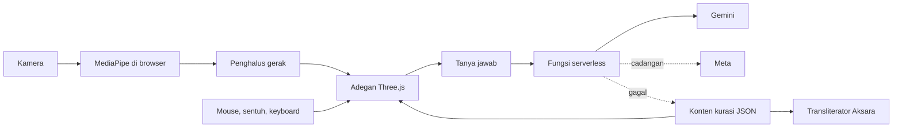

# 03. Arsitektur teknis

Status: usulan stack, tanpa Next.js sesuai permintaan pemilik. Perubahan dependensi wajib dicatat di bagian "Catatan keputusan" di bawah.

## Stack

| Lapisan | Pilihan | Alasan |
|---|---|---|
| Build | Vite + TypeScript | Cepat, tanpa server rendering yang tidak dibutuhkan |
| UI | Svelte 5 (tanpa SvelteKit) | Mengelola keadaan kosong, memuat, galat dengan ringan; tanpa pustaka komponen yang membuat tampilan seragam |
| 3D | Three.js | Kontrol langsung atas performa dan bayangan |
| Gerak | GSAP | Timeline presisi untuk koreografi |
| Pelacakan | MediaPipe Tasks Vision (Hand Landmarker) | Berjalan di browser; WASM dan model di-host sendiri |
| Gaya | CSS buatan sendiri dengan variabel | Identitas sendiri, bukan template |
| Aset 3D | glTF terkompresi (gltf-transform; Draco atau meshopt) | Cepat dimuat |
| Font | Self-host `woff2`; Noto Sans Javanese untuk Aksara | Tidak bergantung CDN; lisensi OFL |
| AI | Satu fungsi serverless sebagai proksi Gemini (utama) dan Meta (cadangan) | Kunci tetap di server |
| Deploy | Vercel (statis plus satu fungsi) | URL aktif untuk juri; alternatif: Cloudflare Pages |
| Uji | Vitest (unit), Playwright (E2E) | Bukti nyata untuk R-35 |

Lingkungan pemilik saat ini: Node 24, npm 11, Git. Python tidak ada dan tidak dibutuhkan.

## Struktur folder

```
kelir/
  src/
    lib/        pelacakan tangan, transliterator Aksara, klien AI, penghalus gerak
    scenes/     adegan 3D: ruang pegang, panggung kelir
    ui/         komponen Svelte
    content/    benda, legenda, sumber, status tinjauan (JSON)
    i18n/       id, jv, aksara
  api/          fungsi serverless AI
  public/       model 3D, font, model dan WASM MediaPipe
  docs/         dokumen proyek
  tests/        unit dan e2e
```

## Alur data



## Prinsip teknis

1. **Kamera di perangkat.** Frame tidak pernah dikirim ke server.
2. **Dua jalur input setara.** Gestur dan kontrol manual memicu aksi yang sama lewat satu lapisan aksi.
3. **Konten sebagai data.** Teks dan sumber ada di JSON dengan skema tegas; UI tidak menanam teks budaya di kode.
4. **Degradasi bertahap.** Tanpa WebGL: gambar dan teks. Tanpa kamera: manual. Tanpa AI: jawaban kurasi. Tanpa jaringan setelah dimuat: konten tetap tampil.
5. **Self-host semua aset kritis**, termasuk WASM dan model MediaPipe, agar demo tidak bergantung CDN.

## Anggaran performa `[ISI target setelah diukur]`

- Ukuran awal dimuat, total ukuran model per benda, jumlah poligon per benda, dan target fps ditetapkan setelah spike teknis, lalu diuji di laptop berspesifikasi rendah dan koneksi lambat.
- Bayangan dan kualitas menurun otomatis bila fps turun di bawah ambang.
- Hero atau gambar utama tidak dimuat malas dan punya dimensi tetap (R-40).

## Keamanan

- Kunci API hanya di variabel lingkungan server (`.env.local`, pengaturan Vercel). Tidak di repo, tidak di klien.
- Fungsi AI: batas laju per IP, batas panjang input, whitelist benda, cache jawaban, tidak menyimpan percakapan.
- `.env*` masuk `.gitignore`. Periksa riwayat git sebelum publikasi.
- Header keamanan dasar dan kebijakan konten yang mengizinkan hanya sumber sendiri.

## Aksara Jawa

Transliterator murni TypeScript, tanpa AI, diuji unit. Spesifikasi di `07-bahasa-dan-aksara.md`.

## Pengujian

| Jenis | Cakupan |
|---|---|
| Unit (Vitest) | Transliterator, penghalus gerak, pemuat konten, skema |
| E2E (Playwright) | Alur Pintu sampai Sumber tanpa kamera; kegagalan: kamera ditolak, AI gagal, konten gagal; mobile dan desktop |
| Performa | Uji manual terukur di perangkat lemah |
| Kontras | `contrast-check.py` untuk semua pasangan warna teks |

## Catatan keputusan

| Tanggal | Keputusan | Alasan |
|---|---|---|
| 2026-11-10 | Tanpa Next.js | Permintaan pemilik; kebutuhan ada di sisi klien |
| 2026-11-10 | Svelte, bukan React | Keadaan UI sederhana dan ringan; 3D ditangani Three.js langsung |
