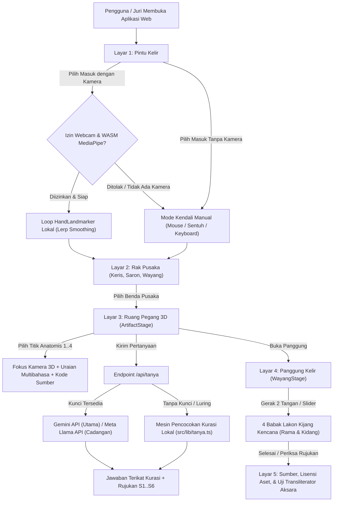
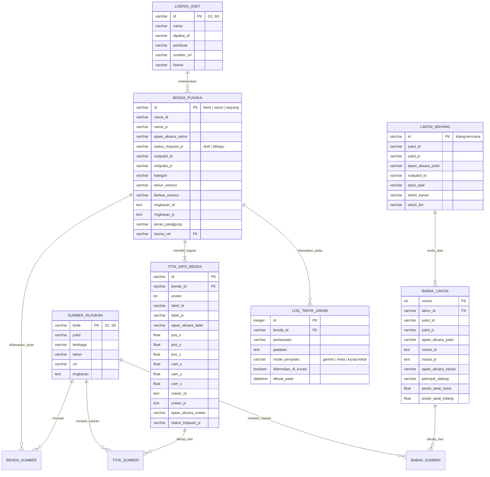
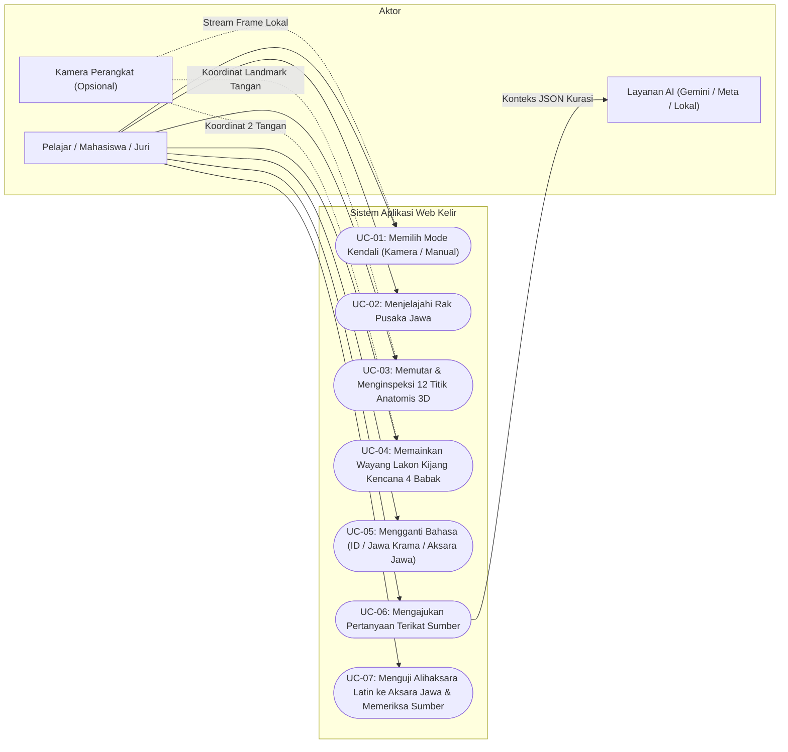
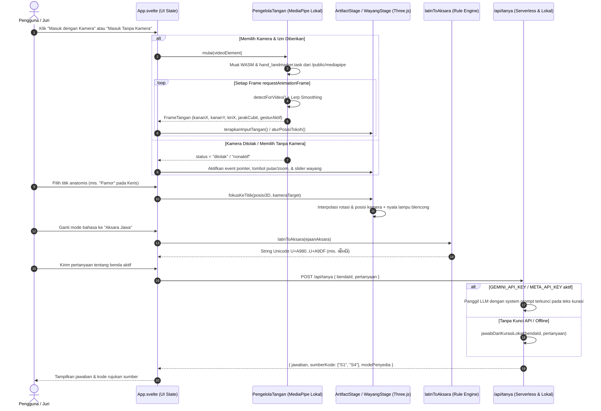
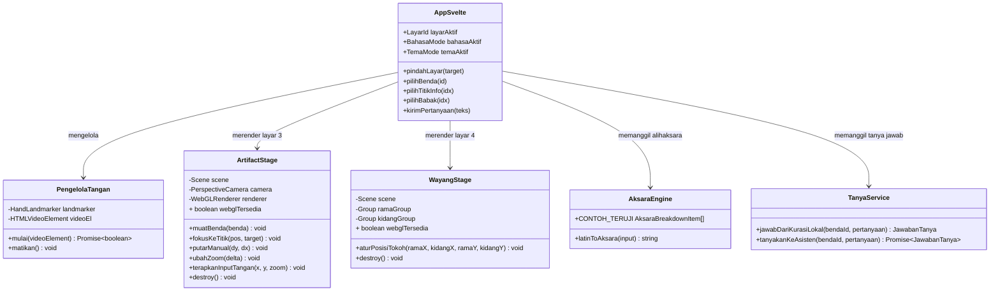
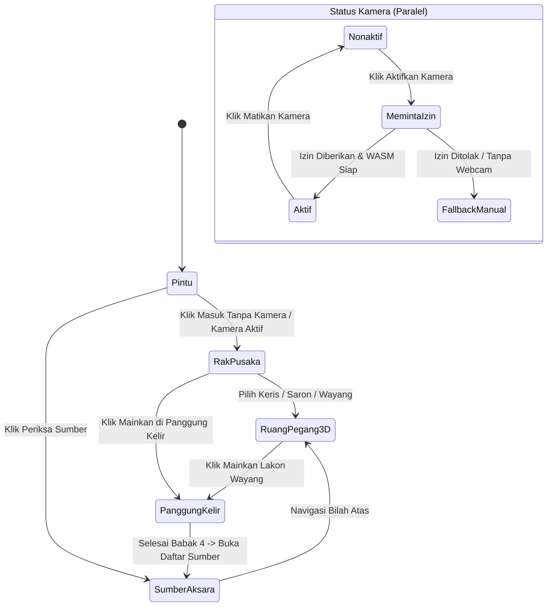

# 12. Skema Alur Sistem: PRD, ERD, UML, DDL, dan DML

Dokumen ini melengkapi berkas rekayasa perangkat lunak **Kelir** (`ꦏꦼꦭꦶꦂ`) untuk penilaian proposal dan dokumentasi teknis **Innovation Competition 2026** (kategori Software Development). Seluruh skema di bawah ini selaras 1:1 dengan struktur tipe TypeScript pada [`src/content/pusaka.ts`](../src/content/pusaka.ts), logika transliterator [`src/lib/aksara.ts`](../src/lib/aksara.ts), dan layanan tanya jawab [`api/tanya.ts`](../api/tanya.ts).

---

## 1. PRD (Product Requirements Document) Detail

### 1.1 Tujuan & Pernyataan Produk
**Kelir** adalah aplikasi web edukasi benda pusaka Jawa dan teater wayang bayangan yang menggabungkan inspeksi model 3D, pelacakan tangan lokal di browser (*MediaPipe Hand Landmarker*), panggung lakon wayang kulit (*Kijang Kencana*), dan alihaksara **Aksara Jawa** berbasis aturan. Seluruh klaim budaya dikunci pada sumber resmi (`S1`–`S6`) tanpa ketergantungan pada perangkat khusus.

### 1.2 Target Pengguna & Kebutuhan Utama
| Kelompok Pengguna | Kebutuhan Utama | Solusi pada Kelir |
|---|---|---|
| **Pelajar & Mahasiswa** | Mengamati bagian anatomis keris, saron, dan wayang yang biasanya tertutup kaca museum, serta memahami lakon wayang dan Aksara Jawa. | Ruang Pegang 3D (12 titik anatomis), Panggung Kelir 4 babak, dan peralihan instan Indonesia / Jawa Krama / Aksara Jawa. |
| **Pendidik / Dosen Muatan Lokal** | Alat peraga kelas yang dapat dibuka di laptop dan proyektor biasa tanpa instalasi rumit dan memiliki rujukan ilmiah jelas. | Berjalan langsung di browser, punya mode tanpa kamera penuh, Mode Siang (terang) untuk proyektor, dan tabel sumber UNESCO/Britannica. |
| **Dewan Juri Kompetisi** | Menguji kestabilan aplikasi, keaslian aset, aksesibilitas tanpa webcam, dan bukti nyata anti-halusinasi AI. | Jalur manual setara 100%, pencocokan kurasi lokal deterministik saat kunci API tidak dipasang, serta suite uji otomatis Vitest & Playwright. |

### 1.3 Matriks Kebutuhan Fungsional (Functional Requirements)
| Kode | Modul | Kebutuhan Fungsional | Prioritas | Status Implementasi |
|---|---|---|---|---|
| **FR-01** | Pintu & Mode Input | Pengguna dapat memilih masuk dengan kamera tangan (*MediaPipe*) atau tanpa kamera (*mouse/sentuh/keyboard*), dan berpindah mode kapan saja di bilah status. | Wajib (P0) | Selesai (`src/ui/App.svelte`, `src/lib/handTracker.ts`) |
| **FR-02** | Rak Pusaka | Menampilkan 3 benda pusaka Jawa (**Keris Jawa**, **Saron Gamelan**, **Wayang Kulit Purwa**) dengan nomor berkas UNESCO, kategori, dan peran panggungnya. | Wajib (P0) | Selesai (`src/content/pusaka.ts`) |
| **FR-03** | Ruang Pegang 3D | Merender geometri 3D benda di depan kain kelir dengan bayangan lampu blencong, mendukung putar, perbesar, dan fokus ke 4 titik anatomis per benda (total 12 titik). | Wajib (P0) | Selesai (`src/scenes/ArtifactStage.ts`) |
| **FR-04** | Panggung Kelir | Merender panggung wayang bayangan dengan dua tokoh (*Sri Rama* di kanan, *Kidang Kencana* di kiri) yang digerakkan dua tangan atau slider sepanjang 4 babak lakon. | Wajib (P0) | Selesai (`src/scenes/WayangStage.ts`) |
| **FR-05** | Tiga Bahasa & Aksara | Mengubah seluruh teks utama antara Bahasa Indonesia (`id`), Bahasa Jawa Krama (`jv` dengan label jujur status `draf`), dan Aksara Jawa (`aksara`). | Wajib (P0) | Selesai (`src/lib/aksara.ts`) |
| **FR-06** | Tanya Jawab Terikat Sumber | Menjawab pertanyaan pengguna hanya dari konteks kurasi benda aktif melalui rantai penyedia Gemini API -> Meta Llama API -> Pencocokan Kurasi Lokal, lengkap dengan kode sumber. | Wajib (P0) | Selesai (`api/tanya.ts`, `src/lib/tanya.ts`) |
| **FR-07** | Transparansi Sumber & Lisensi | Menampilkan tabel sumber resmi (`S1`–`S6`), tabel lisensi aset (`G1`–`M1`), dan penguji interaktif alihaksara Latin ke Aksara Jawa. | Wajib (P0) | Selesai (`src/ui/App.svelte`) |

### 1.4 Kebutuhan Non-Fungsional (Non-Functional Requirements)
| Kode | Aspek | Spesifikasi Terukur |
|---|---|---|
| **NFR-01** | Privasi Kamera | Frame video dari `getUserMedia` diproses di memori lokal oleh WebAssembly MediaPipe dan tidak pernah dikirim melalui jaringan. |
| **NFR-02** | Aksesibilitas & Kontras | Seluruh pasangan warna teks memenuhi rasio kontras WCAG 2.x AA (`>= 4.5:1` teks normal, `>= 3.0:1` batas komponen dan fokus) pada kedua tema (*Malam* dan *Siang*). |
| **NFR-03** | Responsivitas Mobile | Tidak ada *horizontal overflow* pada lebar layar `360px` dan seluruh tombol interaktif memiliki tinggi minimal `44px`. |
| **NFR-04** | Ketahanan (Resilience) | Jika izin kamera ditolak, WebGL tidak tersedia, atau API AI eksternal gagal, aplikasi beralih otomatis ke kendali manual dan kurasi lokal tanpa *crash* (`0` console error). |

---

## 2. Alur Sistem End-to-End (System Flowchart)



---

## 3. ERD (Entity-Relationship Diagram)

Walaupun pada saat runtime di browser data kurasi disajikan sebagai modul statis bertipe kuat agar instan dan tahan luring, seluruh struktur datanya dirancang mengikuti model relasional ternormalisasi (3NF) berikut. Skema SQL lengkap tersedia pada bagian **DDL** dan **DML** di bawah.



---

## 4. UML / EML (Unified Modeling Language & Event Modeling)

### 4.1 Use Case Diagram (Diagram Kasus Penggunaan)



### 4.2 Sequence Diagram: Alur Pelacakan Tangan, 3D, dan Tanya Jawab Terikat Sumber



### 4.3 Class / Component Diagram (Struktur Modul Kode)



### 4.4 State Diagram & Event Modeling (EML)



---

## 5. DDL (Data Definition Language)

Skrip SQL standar (kompatibel dengan PostgreSQL dan SQLite 3) untuk mendefinisikan seluruh tabel, kunci utama (*Primary Key*), kunci tamu (*Foreign Key*), dan batasan integritas (*Check Constraints*). Berkas siap eksekusi juga disimpan di [`docs/sql/schema.sql`](./sql/schema.sql).

```sql
-- ============================================================================
-- DDL (Data Definition Language) Sistem Basis Data Kurasi Kelir
-- Standar: SQLite 3 / PostgreSQL
-- ============================================================================

PRAGMA foreign_keys = ON;

CREATE TABLE IF NOT EXISTS sumber_rujukan (
    kode        VARCHAR(8) PRIMARY KEY,
    judul       VARCHAR(255) NOT NULL,
    lembaga     VARCHAR(255) NOT NULL,
    tahun       VARCHAR(32)  NOT NULL,
    url         VARCHAR(512) NOT NULL,
    ringkasan   TEXT         NOT NULL
);

CREATE TABLE IF NOT EXISTS lisensi_aset (
    id          VARCHAR(8) PRIMARY KEY,
    nama        VARCHAR(255) NOT NULL,
    dipakai_di  VARCHAR(128) NOT NULL,
    pembuat     VARCHAR(255) NOT NULL,
    sumber_url  VARCHAR(512) NOT NULL,
    lisensi     VARCHAR(128) NOT NULL
);

CREATE TABLE IF NOT EXISTS benda_pusaka (
    id                  VARCHAR(32) PRIMARY KEY,
    nama_id             VARCHAR(128) NOT NULL,
    nama_jv             VARCHAR(128) NOT NULL,
    ejaan_aksara_nama   VARCHAR(128) NOT NULL,
    status_tinjauan_jv  VARCHAR(16)  NOT NULL CHECK (status_tinjauan_jv IN ('draf', 'ditinjau')),
    subjudul_id         VARCHAR(255) NOT NULL,
    subjudul_jv         VARCHAR(255) NOT NULL,
    kategori            VARCHAR(128) NOT NULL,
    tahun_unesco        VARCHAR(32)  NOT NULL,
    berkas_unesco       VARCHAR(32)  NOT NULL,
    ringkasan_id        TEXT         NOT NULL,
    ringkasan_jv        TEXT         NOT NULL,
    peran_panggung      TEXT         NOT NULL,
    lisensi_ref         VARCHAR(8)   NOT NULL,
    CONSTRAINT fk_benda_lisensi
        FOREIGN KEY (lisensi_ref) REFERENCES lisensi_aset(id)
        ON UPDATE CASCADE ON DELETE RESTRICT
);

CREATE TABLE IF NOT EXISTS benda_sumber (
    benda_id    VARCHAR(32) NOT NULL,
    sumber_kode VARCHAR(8)  NOT NULL,
    PRIMARY KEY (benda_id, sumber_kode),
    CONSTRAINT fk_bs_benda
        FOREIGN KEY (benda_id) REFERENCES benda_pusaka(id)
        ON DELETE CASCADE,
    CONSTRAINT fk_bs_sumber
        FOREIGN KEY (sumber_kode) REFERENCES sumber_rujukan(kode)
        ON DELETE RESTRICT
);

CREATE TABLE IF NOT EXISTS titik_info_benda (
    id                   VARCHAR(64) PRIMARY KEY,
    benda_id             VARCHAR(32)  NOT NULL,
    urutan               INTEGER      NOT NULL CHECK (urutan >= 1),
    label_id             VARCHAR(128) NOT NULL,
    label_jv             VARCHAR(128) NOT NULL,
    ejaan_aksara_label   VARCHAR(128) NOT NULL,
    pos_x                REAL         NOT NULL,
    pos_y                REAL         NOT NULL,
    pos_z                REAL         NOT NULL,
    cam_x                REAL         NOT NULL,
    cam_y                REAL         NOT NULL,
    cam_z                REAL         NOT NULL,
    uraian_id            TEXT         NOT NULL,
    uraian_jv            TEXT         NOT NULL,
    ejaan_aksara_uraian  VARCHAR(255) NOT NULL,
    status_tinjauan_jv   VARCHAR(16)  NOT NULL CHECK (status_tinjauan_jv IN ('draf', 'ditinjau')),
    CONSTRAINT fk_titik_benda
        FOREIGN KEY (benda_id) REFERENCES benda_pusaka(id)
        ON DELETE CASCADE
);

CREATE TABLE IF NOT EXISTS titik_sumber (
    titik_id    VARCHAR(64) NOT NULL,
    sumber_kode VARCHAR(8)  NOT NULL,
    PRIMARY KEY (titik_id, sumber_kode),
    CONSTRAINT fk_ts_titik
        FOREIGN KEY (titik_id) REFERENCES titik_info_benda(id)
        ON DELETE CASCADE,
    CONSTRAINT fk_ts_sumber
        FOREIGN KEY (sumber_kode) REFERENCES sumber_rujukan(kode)
        ON DELETE RESTRICT
);

CREATE TABLE IF NOT EXISTS lakon_wayang (
    id                  VARCHAR(64) PRIMARY KEY,
    judul_id            VARCHAR(128) NOT NULL,
    judul_jv            VARCHAR(128) NOT NULL,
    ejaan_aksara_judul  VARCHAR(128) NOT NULL,
    subjudul_id         VARCHAR(255) NOT NULL,
    epos_asal           VARCHAR(128) NOT NULL,
    tokoh_kanan         VARCHAR(128) NOT NULL,
    tokoh_kiri          VARCHAR(128) NOT NULL
);

CREATE TABLE IF NOT EXISTS babak_lakon (
    lakon_id            VARCHAR(64)  NOT NULL,
    nomor               INTEGER      NOT NULL CHECK (nomor BETWEEN 1 AND 10),
    judul_id            VARCHAR(128) NOT NULL,
    judul_jv            VARCHAR(128) NOT NULL,
    ejaan_aksara_judul  VARCHAR(128) NOT NULL,
    narasi_id           TEXT         NOT NULL,
    narasi_jv           TEXT         NOT NULL,
    ejaan_aksara_narasi VARCHAR(255) NOT NULL,
    petunjuk_dalang     TEXT         NOT NULL,
    posisi_awal_rama    REAL         NOT NULL,
    posisi_awal_kidang  REAL         NOT NULL,
    PRIMARY KEY (lakon_id, nomor),
    CONSTRAINT fk_babak_lakon
        FOREIGN KEY (lakon_id) REFERENCES lakon_wayang(id)
        ON DELETE CASCADE
);

CREATE TABLE IF NOT EXISTS babak_sumber (
    lakon_id    VARCHAR(64) NOT NULL,
    nomor_babak INTEGER     NOT NULL,
    sumber_kode VARCHAR(8)  NOT NULL,
    PRIMARY KEY (lakon_id, nomor_babak, sumber_kode),
    CONSTRAINT fk_babs_babak
        FOREIGN KEY (lakon_id, nomor_babak) REFERENCES babak_lakon(lakon_id, nomor)
        ON DELETE CASCADE,
    CONSTRAINT fk_babs_sumber
        FOREIGN KEY (sumber_kode) REFERENCES sumber_rujukan(kode)
        ON DELETE RESTRICT
);

CREATE TABLE IF NOT EXISTS log_tanya_jawab (
    id                  INTEGER PRIMARY KEY AUTOINCREMENT,
    benda_id            VARCHAR(32)  NOT NULL,
    pertanyaan          VARCHAR(280) NOT NULL,
    jawaban             TEXT         NOT NULL,
    mode_penyedia       VARCHAR(32)  NOT NULL CHECK (mode_penyedia IN ('gemini', 'meta', 'kurasi-lokal')),
    ditemukan_di_kurasi INTEGER      NOT NULL CHECK (ditemukan_di_kurasi IN (0, 1)),
    dibuat_pada         TIMESTAMP    NOT NULL DEFAULT CURRENT_TIMESTAMP,
    CONSTRAINT fk_log_benda
        FOREIGN KEY (benda_id) REFERENCES benda_pusaka(id)
        ON DELETE CASCADE
);

CREATE INDEX IF NOT EXISTS idx_titik_benda ON titik_info_benda(benda_id, urutan);
CREATE INDEX IF NOT EXISTS idx_babak_lakon ON babak_lakon(lakon_id, nomor);
```

---

## 6. DML (Data Manipulation Language)

Skrip `INSERT`, `SELECT`, `UPDATE`, dan `DELETE` yang merepresentasikan operasi data kurasi serta pembaruan status tinjauan Bahasa Jawa. Berkas siap eksekusi juga disimpan di [`docs/sql/seed_and_queries.sql`](./sql/seed_and_queries.sql).

### 6.1 `INSERT` Data Awal Terverifikasi (Seed Data)

```sql
-- 1. Sumber Rujukan (S1..S6)
INSERT INTO sumber_rujukan (kode, judul, lembaga, tahun, url, ringkasan) VALUES
('S1', 'Indonesian Kris (Berkas 00112)', 'UNESCO Representative List of the Intangible Cultural Heritage of Humanity', '2005 / 2008', 'https://ich.unesco.org/en/RL/indonesian-kris-00112', 'Keris Indonesia diproklamasikan UNESCO pada 2005 dan masuk Daftar Representatif pada 2008 sebagai belati asimetris berpamor yang ditempa oleh empu.'),
('S2', 'Gamelan (Berkas 01760)', 'UNESCO Representative List of the Intangible Cultural Heritage of Humanity', '2021', 'https://ich.unesco.org/en/RL/gamelan-01760', 'Ansambel perkusi tradisional Indonesia yang ditetapkan UNESCO pada Desember 2021.'),
('S3', 'Wayang puppet theatre (Berkas 00063)', 'UNESCO Representative List of the Intangible Cultural Heritage of Humanity', '2003 / 2008', 'https://ich.unesco.org/en/RL/wayang-puppet-theatre-00063', 'Teater boneka bayangan Jawa yang dimainkan dalang di depan layar bercahaya blencong dengan iringan gamelan.'),
('S4', 'Koleksi Etnografi & Historika Museum Negeri Sonobudoyo', 'Dinas Kebudayaan (Kundha Kabudayan) DIY', '1935 / 2026', 'https://sonobudoyo.jogjaprov.go.id', 'Museum sejarah dan kebudayaan Jawa di Jl. Pangurakan No. 6 Yogyakarta yang mendokumentasikan keris, gamelan, dan wayang kulit purwa.'),
('S5', 'Ramayana (Aranya Kanda: Maricha and the Golden Deer)', 'Encyclopaedia Britannica', '2024', 'https://www.britannica.com/topic/Ramayana-Indian-epic', 'Dokumentasi episode raksasa Marica menjelma menjadi kijang emas untuk memancing Rama menjauh dari pertapaan.'),
('S6', 'The Unicode Standard: Javanese Block (U+A980-U+A9DF)', 'The Unicode Consortium', '2023', 'https://www.unicode.org/charts/PDF/UA980.pdf', 'Spesifikasi karakter Aksara Jawa (nglegena, sandhangan, pangkon).');

-- 2. Register Lisensi Aset (G1..M1)
INSERT INTO lisensi_aset (id, nama, dipakai_di, pembuat, sumber_url, lisensi) VALUES
('G1', 'Geometri 3D Prosedural Keris Jawa', 'Ruang Pegang 3D', 'Tim Pengembang Kelir', 'src/scenes/ArtifactStage.ts', 'MIT License'),
('G2', 'Geometri 3D Prosedural Saron Gamelan', 'Ruang Pegang 3D', 'Tim Pengembang Kelir', 'src/scenes/ArtifactStage.ts', 'MIT License'),
('G3', 'Geometri 3D Prosedural Wayang Kulit & Panggung Kelir', 'Ruang Pegang 3D & Panggung Kelir', 'Tim Pengembang Kelir', 'src/scenes/WayangStage.ts', 'MIT License'),
('F1', 'Font Noto Sans Javanese', 'Render Aksara Jawa', 'Google & Monotype', 'https://fontsource.org/fonts/noto-sans-javanese', 'SIL OFL 1.1'),
('F2', 'Font Fraunces Variable & Atkinson Hyperlegible', 'Tipografi Antarmuka', 'Undercase Type & Braille Institute', 'https://fontsource.org', 'SIL OFL 1.1'),
('M1', 'MediaPipe Tasks Vision + Hand Landmarker', 'Pelacakan Tangan Lokal', 'Google', 'https://www.npmjs.com/package/@mediapipe/tasks-vision', 'Apache License 2.0');

-- 3. Benda Pusaka Utama (Keris, Saron, Wayang)
INSERT INTO benda_pusaka (
    id, nama_id, nama_jv, ejaan_aksara_nama, status_tinjauan_jv,
    subjudul_id, subjudul_jv, kategori, tahun_unesco, berkas_unesco,
    ringkasan_id, ringkasan_jv, peran_panggung, lisensi_ref
) VALUES
('keris', 'Keris Jawa', 'Dhuwung Jawi (Keris)', 'dhuwung jawi', 'draf',
 'Belati asimetris berpamor dan bersarung kayu', 'Pusaka wilah asimetris mawi pamor lan warangka kajeng',
 'Tosan Aji / Senjata Pusaka', '2005 / 2008', '00112',
 'Keris adalah belati asimetris khas Nusantara yang tercatat di UNESCO sejak 2005/2008, terdiri atas wilah bersama ganja, hulu/deder, dan warangka kayu.',
 'Dhuwung utawi keris punika pusaka khas Nusantara ingkang kaserat dening UNESCO wiwit warsa 2005 lan 2008.',
 'Kelengkapan busana adat Jawa dan pusaka tokoh satria di dalam pertunjukan wayang.', 'G1'),

('saron', 'Saron Gamelan', 'Saron Gamelan Jawi', 'saron gamelan jawi', 'draf',
 'Instrumen bilah perunggu pembawa kerangka melodi (balungan)', 'Ricikan wilah gangsa pamomot lagu balungan gendhing',
 'Karawitan / Ansambel Gamelan', '2021', '01760',
 'Gamelan ditetapkan UNESCO pada Desember 2021. Saron termasuk kelompok ricikan bilah logam yang memainkan kerangka lagu (balungan).',
 'Gamelan katetepaken dening UNESCO ing wulan Desember 2021. Saron kalebet ricikan wilah gangsa ingkang nabuh balungan gendhing.',
 'Penjaga kerangka melodi gendhing yang mengatur suasana pertunjukan wayang.', 'G2'),

('wayang', 'Wayang Kulit Purwa', 'Ringgit Purwa (Wayang Kulit)', 'ringgit purwa wayang kulit', 'draf',
 'Boneka kulit berukir (tatahan) yang memproyeksikan bayangan di kelir', 'Ringgit cucal mawi tatahan ingkang ngasilaken ayang-ayang ing kelir',
 'Seni Pertunjukan / Teater Bayangan', '2003 / 2008', '00063',
 'Wayang kulit diproklamasikan UNESCO pada 2003 dan masuk Daftar Representatif pada 2008, digerakkan dalang memakai cempurit dan tuding di depan kelir.',
 'Ringgit kulit katetepaken dening UNESCO wiwit warsa 2003 lan 2008, dipunobahaken dening dhalang mawi cempurit lan tuding.',
 'Pemeran utama di layar kelir yang menghidupkan lakon Ramayana dan Mahabharata.', 'G3');

-- 4. Relasi Benda ke Sumber
INSERT INTO benda_sumber (benda_id, sumber_kode) VALUES
('keris', 'S1'), ('keris', 'S4'),
('saron', 'S2'), ('saron', 'S4'),
('wayang', 'S3'), ('wayang', 'S4');

-- 5. Titik Info Anatomis (Contoh 4 Titik pada Keris)
INSERT INTO titik_info_benda (
    id, benda_id, urutan, label_id, label_jv, ejaan_aksara_label,
    pos_x, pos_y, pos_z, cam_x, cam_y, cam_z,
    uraian_id, uraian_jv, ejaan_aksara_uraian, status_tinjauan_jv
) VALUES
('wilah', 'keris', 1, 'Wilah (Bilah Utama)', 'Wilah (Awak Dhuwung)', 'wilah dhuwung',
 0.0, 0.55, 0.04, 0.0, 0.5, 0.0,
 'Wilah adalah badan utama keris yang ditempa dari campuran besi, baja, dan bahan pamor.',
 'Wilah punika perangan utama dhuwung ingkang katempa saking campuran wesi, waja, lan pamor.',
 'wilah punika perangan utama dhuwung saking wesi lan pamor.', 'draf'),
('ganja', 'keris', 2, 'Ganja (Pangkal Melintang)', 'Ganja (Dasar Wilah)', 'ganja wilah',
 0.18, -0.22, 0.05, 0.0, -0.2, 0.0,
 'Ganja terletak melintang di pangkal bawah bilah sehingga membuat pangkal keris tampak melebar dan asimetris.',
 'Ganja mapan malang wonten ing sangandhapipun wilah.',
 'ganja mapan malang ing ngisor wilah.', 'draf'),
('pamor', 'keris', 3, 'Pamor (Alur Logam Tempa)', 'Pamor (Corak Logam)', 'pamor logam',
 -0.04, 0.18, 0.05, 0.0, 0.18, 0.0,
 'Pamor adalah guratan keperakan pada permukaan bilah yang muncul dari teknik tempa lipat logam berbeda jenis oleh empu.',
 'Pamor inggih punika serat pethak ing lumahing wilah saking tempa lipat logam dening empu.',
 'pamor medal saking tempa lipat logam dening empu.', 'draf'),
('warangka', 'keris', 4, 'Hulu & Warangka (Gagang dan Sarung)', 'Deder lan Warangka', 'deder lan warangka',
 -0.32, -0.58, 0.06, -0.15, -0.55, 0.0,
 'Hulu (deder) adalah pegangan berukir kayu, sedangkan warangka adalah sarung pelindung bilah.',
 'Deder punika cepengan dhuwung ingkang kaukir, dene warangka punika wadah kajeng kangge nyimpen wilah.',
 'deder lan warangka kajeng kangge nyimpen wilah.', 'draf');

-- 6. Lakon Wayang & Babak
INSERT INTO lakon_wayang (
    id, judul_id, judul_jv, ejaan_aksara_judul, subjudul_id, epos_asal, tokoh_kanan, tokoh_kiri
) VALUES (
    'kijang-kencana', 'Lakon Kijang Kencana', 'Lampahan Kidang Kencana', 'lampahan kidang kencana',
    'Episode Ramayana (Aranya Kanda): Tipu daya Marica di Hutan Dandaka',
    'Ramayana (Valmiki / Repertoar Wayang Kulit Purwa Jawa)',
    'Sri Rama (Satria Panah)', 'Kidang Kencana (Penjelmaan Marica)'
);

INSERT INTO babak_lakon (
    lakon_id, nomor, judul_id, judul_jv, ejaan_aksara_judul,
    narasi_id, narasi_jv, ejaan_aksara_narasi, petunjuk_dalang,
    posisi_awal_rama, posisi_awal_kidang
) VALUES
('kijang-kencana', 1, 'Babak 1: Pengasingan di Hutan Dandaka', 'Babak 1: Mesanggrah ing Wana Dandaka', 'babak siji wana dandaka',
 'Rama, Dewi Sinta, dan Laksmana hidup di pertapaan hutan Dandaka sementara Rahwana menyusun siasat bersama Marica.',
 'Sri Rama, Dewi Sinta, lan Laksmana mesanggrah wonten ing Wana Dandaka.',
 'sri rama lan dewi sinta ing wana dandaka.',
 'Gerakkan tangan kanan atau slider kanan untuk menegakkan figur Sri Rama.', 0.48, -0.62),
('kijang-kencana', 2, 'Babak 2: Kemilau Kijang Emas', 'Babak 2: Gebyaring Kidang Kencana', 'babak loro kidang kencana',
 'Marica menjelma menjadi kijang emas berbintik perak di dekat pertapaan hingga memikat hati Sinta.',
 'Marica malih rupa dados kidang kencana ingkang mlumpat ing sakiwa tengenipun pertapan.',
 'marica malih rupa dados kidang kencana.',
 'Gerakkan tangan kiri atau slider kiri untuk membawa Kidang Kencana mendekat.', 0.35, -0.18);
```

### 6.2 `SELECT`, `UPDATE`, dan `DELETE` Operasional

```sql
-- A. SELECT: Mengambil seluruh titik anatomis sebuah benda beserta daftar kode sumber dan lisensi geometri
SELECT
    b.id              AS benda_id,
    b.nama_id         AS nama_benda,
    b.berkas_unesco   AS nomor_unesco,
    l.lisensi         AS lisensi_3d,
    t.urutan          AS no_titik,
    t.label_id        AS bagian,
    t.uraian_id       AS penjelasan_anatomis,
    t.status_tinjauan_jv
FROM benda_pusaka b
JOIN lisensi_aset l ON l.id = b.lisensi_ref
JOIN titik_info_benda t ON t.benda_id = b.id
WHERE b.id = 'keris'
ORDER BY t.urutan ASC;

-- B. UPDATE: Memperbarui status tinjauan Bahasa Jawa dari 'draf' menjadi 'ditinjau'
--    setelah diverifikasi oleh penutur ahli Bahasa Jawa
UPDATE titik_info_benda
SET status_tinjauan_jv = 'ditinjau'
WHERE benda_id = 'keris' AND id = 'wilah';

-- C. INSERT: Mencatat log pertanyaan pengguna beserta jalur penyedia yang menjawab
INSERT INTO log_tanya_jawab (benda_id, pertanyaan, jawaban, mode_penyedia, ditemukan_di_kurasi)
VALUES (
    'keris',
    'Bagaimana motif pamor pada bilah keris terbentuk?',
    'Pamor muncul dari teknik tempa lipat logam berbeda jenis oleh seorang empu (Sumber: S1).',
    'kurasi-lokal',
    1
);

-- D. DELETE: Membersihkan log pertanyaan pengujian sebelum pengumpulan karya
DELETE FROM log_tanya_jawab
WHERE ditemukan_di_kurasi = 0;
```
